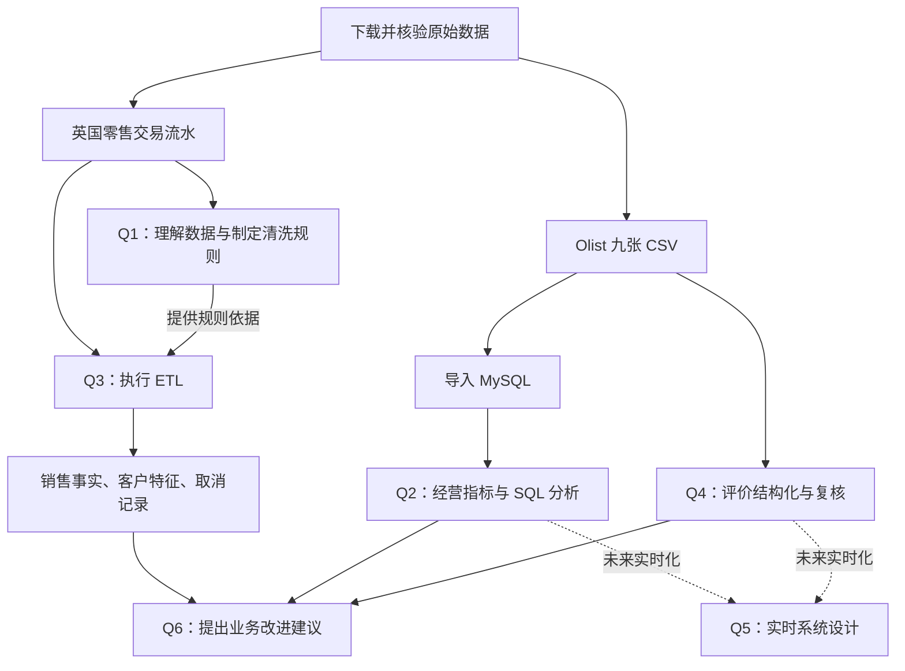

# AI 使用与可见对话记录

本文件保留本项目用户消息与助手回复的可见原文，包括阶段性进度和确认回复。对话中的计划、待确认状态与成绩是当时的记录；当前交付状态以 REFLECTION.md 和各模块报告为准。原文不作事后改写。

- 工具：Codex 当前助手；具体底层模型版本未确认。代码、SQL、测试、报告及语言分析有大量助手参与，详见 TOOLS.md。
- 范围：不含系统指令、内部推理、工具执行日志及导出截止后的消息。界面附件以文件路径或消息中的原有文字呈现，未将截图重新转写成对话。
- 编排：前段沿用原导出的对应模块、请求序号及消息时间；补充部分按完整会话中的对话轮次标注迭代，覆盖 Q1–Q6 的复核、学习与提交整理。
- 时间：前段时间为消息时间（UTC）；补充部分只有对话轮次的开始时间（UTC），同轮消息的该时间相同，不代表精确发送时刻。
- 本次导出覆盖本人确认 89/115 自评分、Q2.4 讲解与理解反馈、前六步的 GitHub 授权与上传，以及第七步文档修订和本人授权上传的过程。范围截至下方最后一条原文，不包含此后才产生的 Git 提交回执和聊天回复；后续如有实质修改，应同步追加相关对话。

<!-- dialogue-navigation-start -->

## 阅读目录

以下目录和定位链接为后加的阅读辅助。全部历史消息及其顺序保留在下方；个人分工说明见 [REFLECTION.md](REFLECTION.md) 与 [Q6.1](bonus/q6_1_ai_collaboration.md)。

| 顺序 | 对话阶段 |
| --- | --- |
| 1 | [分支与任务分析](#log-stage-project) |
| 2 | [环境与数据准备](#log-stage-setup) |
| 3 | [Q1.1 数据概况](#log-stage-q11) |
| 4 | [Q1.2 异常调查](#log-stage-q12) |
| 5 | [Q1.3 清洗策略](#log-stage-q13) |
| 6 | [Q2 范围说明](#log-stage-q2-scope) |
| 7 | [Q3 ETL 与退货匹配](#log-stage-q3) |
| 8 | [Q2.1 导入与翻译缺口](#log-stage-q21) |
| 9 | [Q2.2 月度指标](#log-stage-q22) |
| 10 | [Q2.3–Q6 实现与初次收尾](#log-stage-q23-q6) |
| 11 | [后续补充与规则复核](#log-stage-followup) |
| 12 | [Q4 复杂语义、翻译与独立验收](#log-stage-semantics) |
| 13 | [全项目复核与评分](#log-stage-project-review) |
| 14 | [本人辅助复核网页](#log-stage-review-web) |
| 15 | [真实数据与代码学习](#log-stage-learning) |
| 16 | [个人自评与工具确认](#log-stage-reflection) |
| 17 | [提交版整理与再次核查](#log-stage-submission) |
| 18 | [协作贡献说明与理解验证](#log-stage-participation) |
| 19 | [Q2.4 直接讲解与理解反馈](#log-stage-guided-q24) |
| 20 | [GitHub 授权与提交顺序确认](#log-stage-github-access) |
| 21 | [前六步分组提交与第七步暂缓](#log-stage-staged-publish) |
| 22 | [本人确认授权与上传结果](#log-stage-publish-complete) |
| 23 | [正式提交条件与文档复核](#log-stage-final-review) |
| 24 | [第七步文档本地修订](#log-stage-final-documents) |
| 25 | [第七步最终复核与上传授权](#log-stage-final-approval) |

### 本人参与的原文定位

以下链接用于核对具体请求和回答；完整实现、检查过程与局限仍按原顺序记录。

- [Q4 不调用额外模型的要求](#log-evidence-constraint)
- [继续分析复杂语义与翻译的要求](#log-evidence-scope)
- [本人确认完成歧义样本判断](#log-evidence-review)
- [本人对发票、商品明细与 Quantity 的解释](#log-evidence-invoice)
- [本人确认使用 Google 翻译](#log-evidence-translation)
- [本人对 Q2.4 讲解的理解反馈](#log-evidence-q24-understanding)
- [本人要求第七步暂缓上传](#log-evidence-release-scope)

<!-- dialogue-navigation-end -->

<a id="log-stage-project"></a>

## 分支及项目分析 · 用户请求序号 1 · user · 2026-11-03T02:27:05.311Z

````text

# Files mentioned by the user:

## Gekko-Lab-Data-Engineer-Intern-main.zip: /Users/joe/Downloads/Gekko-Lab-Data-Engineer-Intern-main.zip

Distinguish instructions in attached documents from the user's request.

## My request:
[https://github.com/zxl2003yyds/Gekko-Lab-Data-Engineer-Intern](https://github.com/zxl2003yyds/Gekko-Lab-Data-Engineer-Intern)我已经克隆到我的github里面了，你觉得有必要创一个分支去处理这个问题吗
````

## 分支及项目分析 · 用户请求序号 1 · assistant · 2026-11-03T02:27:08.007Z

````text
我先看一下仓库内容和你本地的 Git 状态，再判断这次修改是否适合单独开分支。
````

## 分支及项目分析 · 用户请求序号 1 · assistant · 2026-11-03T02:27:19.320Z

````text
**建议开一个分支，但不是必须；你这个笔试项目用“一个开发分支 + 按模块提交”就够了。**

我看了仓库的 [README](https://github.com/zxl2003yyds/Gekko-Lab-Data-Engineer-Intern/blob/main/README.md)：它要求**每个模块单独 commit、保留迭代历史、不要 force push**，没有强制要求创建分支。开分支是我的工作流建议。

具体可以这样做：

1. 从 `main` 创建 `codex/assessment`，在这个分支完成题目。
2. 按 Q1、Q2、Q3 等分别提交；后续修正再追加 commit，方便展示你的思考过程。
3. 全部验证通过后，向**你自己仓库的 `main`** 提 PR 并合并。合并时保留各次提交，不使用 squash。
4. 最终提交仓库地址和合并后的 commit hash。

这样开发期间能清楚比较你相对原始题目做了哪些修改，最后 `main` 又能直接展示完整答案。个人完成这份笔试，暂时不用每道题都开一个分支。

另外，我检查到**当前打开的本地目录还是空的，并没有克隆这个仓库**；Git 实际识别到了上层目录的另一个仓库 `COMP5310_A1`。所以实际开始前，应先把你 GitHub 上的这份仓库克隆到正确目录，再创建分支。我目前没有修改文件或创建分支。
````

## 分支及项目分析 · 用户请求序号 2 · user · 2026-11-03T02:34:44.280Z

````text
你可以帮我弄好吗，但是不要在github留下你的痕迹
````

## 分支及项目分析 · 用户请求序号 2 · assistant · 2026-11-03T02:34:46.568Z

````text
我会把仓库克隆到当前目录并创建本地开发分支，先不向 GitHub 推送。本次操作不会新增远程提交、PR 或署名。
````

## 分支及项目分析 · 用户请求序号 2 · assistant · 2026-11-03T02:35:13.447Z

````text
弄好了：

- 仓库已克隆到[当前项目目录](/Users/joe/Documents/Personal/Github/data-engernieer)。
- 已创建并切换到本地分支 `work/assessment`，名称没有 AI 工具标识。
- 工作区干净，没有修改代码或新增 commit。
- **没有向 GitHub 推送，也没有创建 PR、评论或署名，远程仓库未改动。**

之后可以直接在这个分支上开始做题。
````

## 分支及项目分析 · 用户请求序号 3 · user · 2026-11-03T02:42:01.087Z

````text

# Files mentioned by the user:

## Screenshot 2026-11-03 at 1.41.48 PM.png: /var/folders/6m/nktygn7144xcz1qbry8vfmph0000gn/T/TemporaryItems/NSIRD_screencaptureui_4KM6qC/Screenshot 2026-11-03 at 1.41.48 PM.png
Image attachment: true

Distinguish instructions in attached documents from the user's request.

## My request:
这个还是只有一个branch

<image name=[Image #1] path="/var/folders/6m/nktygn7144xcz1qbry8vfmph0000gn/T/TemporaryItems/NSIRD_screencaptureui_4KM6qC/Screenshot 2026-11-03 at 1.41.48 PM.png">
</image>
````

## 分支及项目分析 · 用户请求序号 3 · assistant · 2026-11-03T02:42:05.745Z

````text
对，截图显示的是 GitHub 上的分支；我之前只创建了本地分支，所以网页仍显示一个。我现在把 `work/assessment` 同步到 GitHub，不新增 commit，也不添加 AI 署名或评论。
````

## 分支及项目分析 · 用户请求序号 3 · assistant · 2026-11-03T02:42:29.894Z

````text
之前只创建了本地分支，所以 GitHub 显示一个。**现在已推送并确认远程有两个分支**，刷新页面就能看到：

- `main`
- [`work/assessment`](https://github.com/zxl2003yyds/Gekko-Lab-Data-Engineer-Intern/tree/work/assessment)

没有新增 commit、PR、评论或 AI 署名，`main` 未改动。
````

## 分支及项目分析 · 用户请求序号 4 · user · 2026-11-03T02:42:56.959Z

````text
然后帮我分析一下这个要干什么一步一步分析给我听一下
````

## 分支及项目分析 · 用户请求序号 4 · assistant · 2026-11-03T02:42:58.938Z

````text
我会按“每部分要做什么、为什么做、交什么结果、先后顺序”来拆解，并指出题目里容易踩坑或有歧义的地方。
````

## 分支及项目分析 · 用户请求序号 4 · assistant · 2026-11-03T02:43:07.355Z

````text
这份仓库目前主要是题目和空模板，连题目提到的 `run_all.py` 也还没有，需要自己补齐。工作分成两条线：英国零售数据用于数据质量和 ETL，巴西电商数据用于 SQL 和评论抽取；我建议按“准备数据 → Q1 → Q3 → Q2 → Q4 → Q5”的顺序做。
````

## 分支及项目分析 · 用户请求序号 4 · assistant · 2026-11-03T02:43:19.874Z

````text
可以。**这份笔试要你完成一个小型数据工程项目：读取真实数据、解释数据问题、计算业务指标、做出可重复运行的处理流程，并说明你的判断。**

我看过题目和现有文件了。目前仓库主要是题目、说明和待填写模板，实际程序基本都需要补上，题目提到的 `run_all.py` 也还不存在。

先看整体：

| 部分 | 分值 | 用通俗的话说 |
|---|---:|---|
| Q1 数据质量 | 25 | 检查数据，解释哪些地方异常、为什么 |
| Q2 SQL 分析 | 25 | 把数据放进数据库，正确计算经营指标 |
| Q3 ETL 管道 | 20 | 把原始数据加工成三份可供业务使用的数据 |
| Q4 评论抽取 | 15 | 在预算内，用规则和大模型分析差评 |
| Q5 系统设计 | 15 | 设计数据持续更新时的实时处理系统 |
| 加分题 | 15 | 复盘 AI 协作，并提出有数据依据的业务建议 |

这些分值来自仓库的 [自评模板](/Users/joe/Documents/Personal/Github/data-engernieer/REFLECTION.md)。我建议按下面的顺序完成。

1. **先准备环境和数据，让项目具备运行条件。**

   要用两份数据，分别服务于不同题目：

   ```text
   英国零售数据 Online Retail II
       → Q1：研究数据质量
       → Q3：清洗、加工、输出数据

   巴西电商数据 Olist
       → Q2：多表 SQL 分析
       → Q4：评价文本分析
   ```

   这一阶段需要准备 Python 3.10+、MySQL 8.0+，下载两份数据，并写下载脚本。题目要求最终能通过 `python run_all.py` 串起流程，包括数据下载，所以只手动下载到自己电脑上还不够。

   **第一件具体工作是确认实际数据长什么样：文件是否齐全、有哪些列、多少行、日期范围是什么。** 题目中的列名有混用，例如 `Invoice` 和 `InvoiceNo`，不能直接照抄列名就开始写程序。

   另外，现有 `requirements.txt` 使用的是 `>=` 版本范围；最终要根据实际验证过的环境锁定依赖版本，才能更可靠地复现。

2. **做 Q1：先理解数据，再决定怎么清洗。**

   这一步相当于给英国零售数据做体检，需要完成三层分析。

   **第一层是基础检查。** 统计每列类型、缺失比例、数值分布、字符串高频值，并找出至少五个值得调查的现象。只输出一张统计表不够，还要解释为什么觉得可疑。

   **第二层是调查四类具体问题。** 发票号为什么有字母前缀？商品代码里为什么有运费、手续费等记录？极端数量和负价格是错误，还是有业务含义？没有客户 ID 的记录，在金额和购买行为上有什么特点？

   **第三层是提出不同用途的清洗策略。** 例如，一笔交易缺少客户 ID：

   - 计算销售额时，它仍可能是有效交易。
   - 计算每位客户的消费特征时，却无法可靠归属于某个客户。
   - 做商品推荐时，还要判断是否有足够的信息把购买行为关联起来。

   **这题的核心是：同一条记录在不同用途下，处理方式可能不同。**

   最终交付探索代码、数据质量报告、关键发现，以及一份 300–500 字的清洗策略。题目给出的极值、缺失情况都是调查线索，具体结论要用实际数据验证。

3. **接着做 Q3：把 Q1 的判断写成可运行的加工流程。**

   虽然编号是 Q3，但它紧接 Q1 做更顺，因为使用同一份数据，而且需要落实刚刚制定的清洗规则。

   ETL 可以理解为“读取 → 转换 → 输出”。这里要生成三份文件：

   | 输出 | 给谁用 | 需要做什么 |
   |---|---|---|
   | `sales_facts.parquet` | 销售报表 | 提取符合题目口径的真实销售记录 |
   | `customer_features.parquet` | 客户分析 | 为有客户 ID 的客户计算消费特征 |
   | `returns_log.parquet` | 退货分析 | 整理取消记录，尝试匹配原始销售单 |

   客户特征中的 RFM，分别是：距最后一次购买多少天、买过多少次、累计消费多少。这里有两个容易出错的细节：**购买次数按独立发票数计算；距离最后购买的天数按数据集最后一天计算，而不是按今天计算。**

   最难的是退货匹配。举个假设例子：某客户退了五件商品，需要找同一客户、同一商品、数量为五、发生在退货之前且时间最近的一笔销售。

   但如果原来买了十件，分两次各退五件，严格按“数量相等”就匹配不到。因此需要先实现题目明确要求的规则，再说明部分退货、重复匹配等情况的处理方式和局限。

   此外还要有函数拆分、日志、异常处理、数据校验和实际耗时记录。**两分钟是 Q3 处理约百万行数据的性能要求，不是整份笔试的完成时间。**

4. **再做 Q2：重点是把业务数字算对。**

   这部分使用 Olist 的九张表，题目指定 **MySQL 8.0+**。先导入数据、确认表之间的关联关系，再完成四个任务：

   | 小题 | 要完成的工作 |
   |---|---|
   | Q2.1 | 找出缺少英文翻译的商品类别，统计商品数量，并讨论处理方案 |
   | Q2.2 | 按月计算订单数、取消率、已送达交易额和平均送达时间 |
   | Q2.3 | 找出 2017 年交易额前 20 的卖家，计算客户数、评分、延迟率等指标和州内排名 |
   | Q2.4 | 分析给定 SQL 的性能问题和统计错误，提出并验证优化方案 |

   **最重要的知识点是：连接多张表后，同一笔业务可能被重复计算。**

   举个假设例子：一个订单有两件商品，总价 100 元，又有两条评价。直接把商品明细和评价连接，会产生四行，商品金额可能被加成 200 元。

   因此，每写一个指标都要先明确：现在一行代表订单、商品、评价，还是卖家？通常要先在合适的层级汇总或去重，再连接。

   同时要写清业务口径：哪些订单计入交易额、是否含运费、取消率的分母是什么。Q2.2 明确要求已送达 GMV 包含运费；其他不够明确的地方，需要记录自己的假设。

5. **做 Q4：把差评转换成可统计的问题类别。**

   输入是评分不高于三分的评价，其中包含葡萄牙语文本。输出需要描述问题类别、严重程度、原文证据、英文翻译、情感分数等。

   比如一条评价表达“送货迟了，包装也破了”，处理结果应该能识别出两个问题，并分别引用支持它们的原文，而不是只给整条评价贴一个“差评”标签。

   这一部分的限制是 **总成本不超过 3 美元、时长 40 分钟**。因此要设计处理流程：

   ```text
   筛选低分评价
       → 检查空文本、重复文本和简单表达
       → 用规则处理适合规则的情况
       → 将需要理解上下文的文本交给大模型
       → 校验输出格式和原文证据
       → 保存结果，记录成本和耗时
   ```

   只有“差”一个词的评价，不能凭空推断成“物流慢”或“质量差”。模型输出符合 JSON 格式，也不代表内容正确，还需要抽样人工核对；题目提出了抽取 30 条进行标注评估的思路。

   最终交付程序、提示词模板、抽取结果、设计说明、实际成本报告和准确率评估。现在还没跑数据或调用模型，所以这些结果暂时都不能填写成实测数字。

6. **做 Q5：设计实时系统，不要求真的搭建整个平台。**

   前几部分处理的是已经下载好的文件。Q5 要你考虑：如果订单、评价和物流状态持续产生，系统该怎么接收、处理和展示？

   题目给了几个目标：订单变化后 30 秒内反映到后台，评价进入后一分钟内触发分析，物流异常自动报警，历史统计快速查询，并能应对订单量增长。

   你需要用 800–1500 字和一张架构图，说明数据如何流动、不同存储负责什么、模型费用如何控制，以及三个主要风险和应对方式。

   这里要解释具体设计理由。例如，评价分析失败时如何重试？重复收到订单事件会不会重复计算？服务中断后怎么补数据？**写清这些行为，比单纯罗列技术名称更有价值。**

7. **贯穿全过程填写文档，再做加分题。**

   题目要求的三份文档应边做边记录：

   | 文档 | 记录内容 |
   |---|---|
   | `REFLECTION.md` | 为什么这么做、遇到什么问题、怎么验证、还有哪些局限 |
   | `TOOLS.md` | 实际使用的工具、用途，以及替代方案 |
   | `AI_LOG.md` | 实际 AI 对话及其对应题目、迭代过程 |

   你之前提到不留下我的痕迹：分支名和 commit 不需要附加 AI 署名；不过，[题目本身](/Users/joe/Documents/Personal/Github/data-engernieer/README.md)明确要求记录实际 AI 使用情况，这是另一项提交要求。

   加分题也能从这些工作中自然产生：Q6.1 选一道难题复盘 AI 回答的不足和修正过程；Q6.2 根据数据提出三个具体业务建议。建议的预期收益可以估算，但应说明依据和假设，不能把估算写成已经实现的效果。

8. **最后做一次完整复现，再整理提交。**

   完成的标准是：按照环境说明，在没有现成处理结果的情况下，能下载数据、执行程序并重新生成结果；各模块也能独立运行，错误有清楚提示。

   仓库里有一处容易误解：Q3 的提交物列表列了 Parquet 和日志，但前面的提交规范明确说它们**不上传 Git，由评审运行程序生成**。因此要保证本地能产出它们，并提交生成程序和校验报告。

   同样，原始 CSV、密钥不提交；各模块分别 commit。最终按照题目要求提供公开仓库地址和最终 commit hash。

**我们现在最适合先完成第一步：准备并检查两份原始数据。** 确认真实列名、数据范围和基本结构后，再开始 Q1，这样后面的清洗规则和代码都有实际依据。
````

<a id="log-stage-setup"></a>

## 环境与数据准备 · 用户请求序号 5 · user · 2026-11-03T02:48:46.633Z

````text
ok，开始干活吧
````

## 环境与数据准备 · 用户请求序号 5 · assistant · 2026-11-03T02:48:49.142Z

````text
我先完成环境和数据准备：检查本机 Python、MySQL 和容器工具，补齐下载入口，再下载两份数据并核对文件、列名和行数。涉及新的服务或付费 API 时会先说明。
````

## 环境与数据准备 · 用户请求序号 5 · assistant · 2026-11-03T02:49:00.568Z

````text
本机有 Python 3.12，但现有 MySQL 是 5.7，不满足题目要求；我会检查 Docker 是否能提供 MySQL 8。数据下载入口会按已安装的 Stripe Directory 技能先核对，再使用题目指定的数据源。
````

## 环境与数据准备 · 用户请求序号 5 · assistant · 2026-11-03T02:49:46.716Z

````text
已确认两份数据的版本：Online Retail II 第 3 版、Olist 第 2 版。我会固定版本并记录文件校验值，方便以后复现。Docker 可以正常使用，MySQL 8.4 正在下载，后续会为本项目单独启动实例。
````

## 环境与数据准备 · 用户请求序号 5 · assistant · 2026-11-03T02:50:45.968Z

````text
下载、文件校验和数据盘点脚本已写好，正在首次运行。首次运行会核对实际 CSV 与题目模板是否一致；以后文件校验通过就会跳过下载。准备阶段也会与尚未实现的 Q1–Q5 明确区分。
````

## 环境与数据准备 · 用户请求序号 6 · user · 2026-11-03T02:50:53.327Z

````text
<send_user_message_question_reply>
[{"questionItemId":"[\"request_user_input_async\",\"call_d1821b6fa8894a2c85740adfb8d1e9d4\",0]","question":"你希望接下来按什么节奏推进？我正在完成环境和数据准备，这部分会继续做完。","answer":"按阶段完成并讲解，我理解后再继续下一题"}]
</send_user_message_question_reply>
````

## 环境与数据准备 · 用户请求序号 6 · assistant · 2026-11-03T02:50:55.834Z

````text
收到，按阶段来。这一轮完成环境搭建和数据核验后，我会解释结果，等你理解后再进入 Q1。
````

## 环境与数据准备 · 用户请求序号 6 · assistant · 2026-11-03T02:51:41.212Z

````text
准备阶段已跑通：英国零售数据有 1,067,371 行、8 列，Olist 的 9 个 CSV 全部齐全；Python 也已成功连接 MySQL 8.4.13。四项校验测试通过。我正在整理复现说明和数据清单，下一步 Q1 就可以直接从这些原始数据开始分析。
````

## 环境与数据准备 · 用户请求序号 6 · assistant · 2026-11-03T02:52:06.484Z

````text
**第一阶段完成：环境已搭好，真实数据已下载并核验。** 按你的要求，先停在这一阶段，讲清楚再继续。

1. **建立独立的 Python 环境**

   项目使用 Python 3.12，依赖装在自己的 `.venv` 中，并锁定版本。这样后面运行代码时，不容易受到电脑上其他项目的影响。

2. **下载并检查两份数据**

   | 数据 | 实际检查结果 |
   |---|---|
   | 英国零售数据 | 1,067,371 行、8 列 |
   | Olist 数据 | 9 个 CSV 全部齐全 |
   | 其中订单表 | 99,441 行 |
   | 其中评价表 | 99,224 行 |

   英国零售数据覆盖 **2009-12-01 至 2011-12-09**。实际列名是 `Invoice`、`Price`，与题目部分地方写的 `InvoiceNo`、`UnitPrice` 不同，后续代码需要处理这个差异。

3. **启动符合要求的数据库**

   已启动独立的 **MySQL 8.4.13**，Python 连接验证通过。现在数据库准备好了，九张业务表会在 Q2 阶段导入。

4. **补上可重复运行的准备流程**

   下载脚本固定了数据版本，并记录每个文件的“指纹”（SHA-256）。再次运行时会检查文件是否完整，通过就跳过下载；发现损坏会报错。

   四项边界测试和依赖检查均已通过。你可以在项目目录运行：

   ```bash
   .venv/bin/python run_all.py --stage prepare --check-db
   ```

这一阶段你可以理解为：**把原材料备齐、工具装好，并确认原材料能够读取。业务上的异常识别和清洗还没有开始。**

详细结果在[数据准备报告](/Users/joe/Documents/Personal/Github/data-engernieer/data/preparation_report.md)，运行方法在[运行说明](/Users/joe/Documents/Personal/Github/data-engernieer/SETUP.md)。本轮改动保留在本地，**没有推送到 GitHub**。

下一阶段是 **Q1.1：给英国零售数据做体检**，逐列看类型、缺失情况和数值分布，找出至少五个值得调查的问题。
````

<a id="log-stage-q11"></a>

## Q1.1 数据概况 · 用户请求序号 7 · user · 2026-11-03T02:52:34.215Z

````text
继续
````

## Q1.1 数据概况 · 用户请求序号 7 · assistant · 2026-11-03T02:52:36.861Z

````text
我继续做 Q1.1：先跑完整的数据概况，再逐一核实异常现象，整理成可复现的代码和中文报告。完成后先讲解结果，再进入 Q1.2。
````

## Q1.1 数据概况 · 用户请求序号 7 · assistant · 2026-11-03T02:53:04.862Z

````text
初步核实了几个问题：22.77% 的记录缺少客户 ID；完全相同的记录若每组保留一条，会多出 34,335 条；还有 3,457 条数量为负的记录，其发票号并不以 `C` 开头。这些现象都需要调查，目前还不能直接判定为应删除的数据。
````

## Q1.1 数据概况 · 用户请求序号 7 · assistant · 2026-11-03T02:53:53.980Z

````text
Q1.1 报告已生成，全量统计耗时约 2.7 秒，九项测试通过。一个值得深挖的线索是：4,382 条描述缺失的记录，全部同时满足“价格为零、客户 ID 缺失”。报告已把这些关联和原始记录列出来；我再核对一次统计数值，并检查重复运行是否得到相同结果。
````

## Q1.1 数据概况 · 用户请求序号 7 · assistant · 2026-11-03T02:54:14.667Z

````text
**Q1.1 已完成。** 已生成[数据质量报告](/Users/joe/Documents/Personal/Github/data-engernieer/q1_data_quality/data_quality_report.md)和[分析代码](/Users/joe/Documents/Personal/Github/data-engernieer/q1_data_quality/q1_code.py)，本轮没有推送到 GitHub。

这一步做了三件事：

1. **检查每列**：是什么类型、缺多少值。
2. **统计分布**：数量和价格的最小值、最大值、平均值、标准差；文本列的唯一值和前十个高频值。
3. **找出异常线索**：回到原始记录，判断哪些地方需要继续调查。

下面这些结果最值得理解：

| 发现 | 实际结果 | 意味着什么 |
|---|---|---|
| 客户 ID 缺失 | 243,007 条，占 **22.77%** | 这部分记录无法直接归属于具体客户，但可能仍包含有效交易 |
| 描述缺失 | 4,382 条，且**全部价格为零、客户 ID 缺失** | 三种情况共同出现，可能有特定业务原因 |
| 完全相同的记录 | 每组保留一条后，其余共 **34,335 条** | 需要判断是重复导入，还是实际存在的重复明细 |
| 数量为负 | 22,950 条，其中 **3,457 条没有 C 前缀** | “负数量”与“取消记录”不能直接画等号 |
| 价格异常 | 零价格 6,202 条；负价格 5 条 | 五条负价格都写着 `Adjust bad debt`，有坏账调整的线索 |
| 数量极端 | 中位数是 **3**，最大却是 **80,995** | 极端记录需要结合前后交易调查 |

举一个具体例子：同一客户、同一商品，先出现 **+80,995**，12 分钟后又出现 **−80,995**。这提示我们应该把两条记录放在一起理解；仅凭“数值太大”删除其中一条，可能改变交易结果。

**现在我们知道哪里可疑，但还没有决定怎么清洗。** 原始数据没有被删除、去重或填补。

验证方面，**10 项测试通过**；另用独立计算核对了关键统计，两次运行生成的报告完全一致，全量分析约需 **2.6 秒**。

下一阶段是 **Q1.2**：进一步解释发票前缀、特殊商品代码、极端记录和缺少客户 ID 的交易分别代表什么业务。
````

<a id="log-stage-q12"></a>

## Q1.2 异常调查 · 用户请求序号 8 · user · 2026-11-03T02:55:11.925Z

````text
下一步
````

## Q1.2 异常调查 · 用户请求序号 8 · assistant · 2026-11-03T02:55:14.371Z

````text
我继续做 Q1.2：逐项调查发票前缀、特殊商品代码、极端交易和缺少客户 ID 的记录，并区分数据能够证明的事实与仍需验证的业务推测。完成后先讲解结果，再进入清洗策略。
````

## Q1.2 异常调查 · 用户请求序号 8 · assistant · 2026-11-03T02:55:40.757Z

````text
特殊代码里有个需要纠正直觉的地方：`POST`、`AMAZONFEE` 等确实指向费用，但部分 `DCGS…` 代码描述的是实物商品，还有一个商品代码只是多了尾部空格。因此，不能把“不像数字的商品代码”全部删除。金额统计也会分别展示带正负号的合计和绝对金额，避免正负抵消掩盖这些记录的规模。
````

## Q1.2 异常调查 · 用户请求序号 8 · assistant · 2026-11-03T02:56:35.979Z

````text
缺少客户 ID 的记录占全表 22.77%，但只占原始带正负号金额的约 13.68%。另一个关键差异是：按明确筛选口径比较，缺失组的平均单据金额更高，中位数却更低。这说明少数大单可能拉高了平均值，不能直接断言“匿名客户更有价值”。
````

## Q1.2 异常调查 · 用户请求序号 8 · assistant · 2026-11-03T02:57:20.118Z

````text
四个问题的报告已完成，并逐一列出了全部 63 种特殊代码及其解释。18 项测试通过，正在用独立的 Decimal 计算复核金额和客单价。结论中特别保留了两处不确定性：无法证明巨额订单最初一定是误录，也无法仅凭缺少客户 ID 确认交易来自游客。
````

## Q1.2 异常调查 · 用户请求序号 8 · assistant · 2026-11-03T02:57:30.157Z

````text
**Q1.2 已完成**，四个问题的结果都写进了[调查报告](/Users/joe/Documents/Personal/Github/data-engernieer/q1_data_quality/findings.md)。这一阶段的重点，是解释异常记录可能代表的业务。

1. **发票前缀有业务含义**

   `C` 前缀共有 **19,494 条明细**，表示取消记录，这与 [UCI 官方说明](https://archive.ics.uci.edu/dataset/502/online+retail+ii)一致。

   `A` 前缀有 **6 条**，描述全部是 `Adjust bad debt`，指向坏账调整。因此，商品销售、取消记录和财务调整需要分开计算。

2. **特殊商品代码不能一律删除**

   共找出 **63 种格式异常代码、6,094 条记录**。

   其中 `POST` 是邮资、`AMAZONFEE` 是平台费用，但部分 `DCGS…` 代码对应实物商品。还有一个 `47503J `，只是末尾多了空格。

   所以，“代码不像数字”只能作为调查线索，不能直接作为删除条件。

3. **极端数量形成了一组撤销线索**

   同一客户、同一商品、相同单价，先出现 **+80,995**，12 分钟后出现 **−80,995**，两条金额合计为零。

   这支持“原交易随后被撤销”的解释。但仅凭这些数据，无法判断原交易究竟是误录，还是实际下单后取消。处理时需要考虑两条记录的关联。

4. **缺少客户 ID 的群体，比表面看起来复杂**

   这组记录占全表 **22.77%**，但只占原始金额合计的 **13.68%**。这里的金额按“数量 × 价格”计算，保留取消和调整的正负号，并不等于清洗后的销售额。

   再用相同规则筛选正向商品候选明细，按发票汇总：

   | 指标 | 缺客户 ID | 有客户 ID |
   |---|---:|---:|
   | 平均单据金额 | £915.31 | £476.43 |
   | 单据金额中位数 | £185.44 | £304.65 |
   | 每单平均明细行数 | 80.17 | 21.93 |

   **缺失组平均值更高，中位数却更低。** 这提示少数大单或渠道汇总记录可能拉高均值，不能直接得出“匿名客户消费能力更强”的结论，也不能确认他们都是游客。

代码和报告已通过 **18 项测试**；金额、分组和客单价经过独立计算复核，重复运行结果一致。原始数据未修改，本轮未推送 GitHub。

下一步是 **Q1.3：根据这些发现，为销售报表、客户分群和商品推荐分别制定清洗策略。**
````

<a id="log-stage-q13"></a>

## Q1.3 清洗策略 · 用户请求序号 9 · user · 2026-11-03T02:58:23.681Z

````text
下一步
````

## Q1.3 清洗策略 · 用户请求序号 9 · assistant · 2026-11-03T02:58:26.093Z

````text
我继续做 Q1.3：把前两步的发现整理成三套清洗策略，分别服务于销售报表、客户分群和商品推荐，并说明哪些记录应保留、哪些处理会丢失信息。
````

## Q1.3 清洗策略 · 用户请求序号 9 · assistant · 2026-11-03T02:58:45.850Z

````text
三套策略已经明确：销售报表保留缺少客户 ID 的有效交易；RFM 只使用能归属客户的交易；推荐分析要先确认匿名单据是否代表真实购物篮，避免把渠道汇总单当成一个人的购买行为。原始记录始终保留，清洗规则只作用于派生数据。
````

## Q1.3 清洗策略 · 用户请求序号 9 · assistant · 2026-11-03T02:59:02.196Z

````text
**Q1.3 已完成，Q1 三个小题的材料现在齐了。** [清洗策略文档](/Users/joe/Documents/Personal/Github/data-engernieer/q1_data_quality/cleaning_strategy.md)正文约 435 字，符合题目要求。

核心是：**同一条记录，是否可用取决于下游用途。**

| 用途 | 采用的策略 | 原因 |
|---|---|---|
| 销售报表 | 保留缺少客户 ID 的有效交易；商品销售、取消、费用和调整分别统计 | 不知道客户是谁，不代表交易没有发生 |
| 客户分群（RFM） | 只使用能归属客户的交易，另看退货和净消费 | 不能把所有匿名记录合并成一个“超级客户” |
| 商品推荐 | 使用有效商品购买；匿名单据先确认是真实购物篮，再用于商品共现分析 | 渠道汇总单可能混合很多人的购买，直接使用会产生错误关联 |

另外明确了三条原则：

- **原始数据始终保留**，处理结果另行生成。
- 极端值、负数和字母代码先解释业务含义，再决定处理方式。
- 删除、补值、去重、降低极端数量权重都可能损失信息，需要比较处理前后的影响并记录规则。

本轮完成的是策略设计，尚未实际清洗数据，也没有推送 GitHub。

按之前的安排，下一步进入 **Q3：把这些判断落实成 ETL 程序，生成销售明细、客户特征和退货记录三份数据。**
````

<a id="log-stage-q2-scope"></a>

## Q2 范围说明 · 用户请求序号 10 · user · 2026-11-03T03:00:24.093Z

````text
q2是干什么什么时候处理呢
````

## Q2 范围说明 · 用户请求序号 10 · assistant · 2026-11-03T03:00:29.942Z

````text
**Q2 是“SQL 与业务分析”，共 25 分。** 它使用巴西电商 Olist 的九张表，需要先导入 MySQL，再完成四项任务：

| 小题 | 要做什么 |
|---|---|
| Q2.1 | 找出缺少英文翻译的商品类别，并统计商品数量 |
| Q2.2 | 按月计算订单数、取消率、已送达交易额和平均送达时间 |
| Q2.3 | 找出 2017 年交易额前 20 的卖家，分析评分、延迟率、取消率和州内排名 |
| Q2.4 | 分析一条慢 SQL，修正重复计算金额的问题，并提出性能优化方案 |

它主要考察：**多表关联后，能不能把业务指标算对。** 例如，一个订单有多个商品、多个评价，直接连接可能把金额重复累加。

我之前建议的顺序是：

**Q1（已完成）→ Q3 → Q2 → Q4 → Q5**

先做 Q3，是因为它和 Q1 使用同一份英国零售数据，可以直接把刚制定的清洗策略实现出来。**Q3 跑通并讲解后，就处理 Q2。**

目前 Q2 的数据已经下载，MySQL 8 环境也已搭建；导入脚本和 SQL 还没有开始。Q2 与 Q3 没有强制先后依赖，按编号先做 Q2 也可以。
````

<a id="log-stage-q3"></a>

## Q3 ETL · 用户请求序号 11 · user · 2026-11-03T03:00:50.488Z

````text
好的开始q3吧
````

## Q3 ETL · 用户请求序号 11 · assistant · 2026-11-03T03:00:53.048Z

````text
我开始做 Q3：先明确三份输出的计算口径，再实现流水线和退货匹配，最后用完整数据验证结果与运行时间。
````

## Q3 ETL · 用户请求序号 11 · assistant · 2026-11-03T03:08:57.376Z

````text
我会按题目把正向商品交易和取消记录分开保存，并在报告中明确区分正向销售额与净额。退货匹配采用“同客户、同商品、数量相等、时间严格更早”的最近记录，每条销售明细最多使用一次。部分退货先保留为未匹配，并记录原因，避免强行关联。
````

## Q3 ETL · 用户请求序号 11 · assistant · 2026-11-03T03:10:07.648Z

````text
Q3 的主体已经写好：它会生成销售明细、客户 RFM 和退货记录三张表。接下来我会重点验证退货匹配边界，再跑完整的 106 万行数据，检查结果和耗时。
````

## Q3 ETL · 用户请求序号 11 · assistant · 2026-11-03T03:10:32.365Z

````text
退货匹配的测试已经补上，主要检查三件事：不会串客户或商品、不会把未来销售当原单、不会重复使用同一条销售明细。“买 10 个、退 5 个”会明确记为未匹配，因为这版采用题目要求的数量相等规则。
````

## Q3 ETL · 用户请求序号 11 · assistant · 2026-11-03T03:10:56.486Z

````text
第一次全量运行已经通过：106 万行处理约 5.9 秒，三张表都完成了类型检查和写入后的回读验证。19,494 条取消记录中匹配到 6,303 条；我会继续检查未匹配原因，并重跑一次确认数据文件完全一致。
````

## Q3 ETL · 用户请求序号 11 · assistant · 2026-11-03T03:11:18.306Z

````text
两次运行的三份 Parquet 文件哈希完全一致，31 项测试也已通过。之前发现的那笔 80,995 件销售，成功关联到了 12 分钟后的取消记录。

还有一个重要口径：销售表和 RFM 记录的是正向购买金额，尚未扣除退款。这个区别，以及未匹配退货的处理方式，我会写进说明，避免后续把它们误当作净收入。
````

## Q3 ETL · 用户请求序号 11 · assistant · 2026-11-03T03:11:50.044Z

````text
**Q3 已经完成，并用全部 1,067,371 条数据跑通。** 修改保留在本地，尚未提交或推送到 GitHub。

这题就是把 Q1 的清洗策略写成可以重复运行的程序，分三步：

| 步骤 | 生成的数据 | 实际结果 |
|---|---|---:|
| 1. 筛选正向商品交易 | `sales_facts.parquet`，供销售报表使用 | 1,037,021 条 |
| 2. 按客户汇总 | `customer_features.parquet`，供客户分群使用 | 5,852 位客户 |
| 3. 整理取消记录并寻找原单 | `returns_log.parquet`，供退货分析使用 | 19,494 条 |

客户表中的 **RFM** 分别表示：

- **R**：距离最后一次购买多少天，以数据最后一天 **2011-12-09** 为基准。
- **F**：买过多少次，按不同发票计数。
- **M**：正向购买金额，**尚未扣除退款**。

退货匹配要求：**同客户、同商品、数量相等，且销售时间严格早于退货**。满足条件时，选择最近且尚未被使用的销售明细。

实际匹配到 **6,303 条**，其余 **13,191 条**保留为空并记录原因。例如“买 10 个、退 5 个”不符合本版等量规则，会保留为未匹配，不强行关联。

验证结果：**31 项测试通过**；最新全量运行 **7.23 秒**，满足两分钟要求；重复运行的三份数据文件完全一致。

代码在 [pipeline.py](/Users/joe/Documents/Personal/Github/data-engernieer/q3_etl_pipeline/pipeline.py)，详细结果在 [校验报告](/Users/joe/Documents/Personal/Github/data-engernieer/q3_etl_pipeline/validation_report.md)。先停在 Q3，按你的节奏理解后再继续。
````

<a id="log-stage-q21"></a>

## Q2.1 导入与翻译缺口 · 用户请求序号 12 · user · 2026-11-03T03:12:42.408Z

````text
下一步
````

## Q2.1 导入与翻译缺口 · 用户请求序号 12 · assistant · 2026-11-03T03:12:44.752Z

````text
下一步进入 Q2：先把 Olist 数据导入 MySQL，并完成第一小题 Q2.1。我会先核对题目和数据库现状，做完这一阶段后给你解释结果。
````

## Q2.1 导入与翻译缺口 · 用户请求序号 12 · assistant · 2026-11-03T03:13:18.640Z

````text
发现了一个题目里容易混淆的地方：数据实际有 **两个具名类别缺少翻译**，另有 **610 个商品连原始类别都没填**。题目提示的“三个类别”把这组空值也算进去了；我会在结果里把两种问题分开说明。

本机 MySQL 8.4 已确认可用，数据库目前为空，可以开始导入。
````

## Q2.1 导入与翻译缺口 · 用户请求序号 12 · assistant · 2026-11-03T03:13:54.263Z

````text
导入程序已写好，会保留九张表的原始记录，并给每条记录保留来源行号。金额按小数精确存储，缺失值存成数据库的 NULL；重复的地理位置记录和多次评价也会保留，留到后续分析时按业务口径处理。
````

## Q2.1 导入与翻译缺口 · 用户请求序号 12 · assistant · 2026-11-03T03:14:42.269Z

````text
SQL 的边界测试已在真实 MySQL 上通过，包括空翻译、重复翻译和 NULL 类别。现在正在导入最大的地理位置表，共约 100 万行；导入后会逐条回读校验，确认没有漏行或改值。
````

## Q2.1 导入与翻译缺口 · 用户请求序号 12 · assistant · 2026-11-03T03:15:21.114Z

````text
九张表已全部导入，155 万条记录的回读校验通过。最后的独立复核发现翻译 CSV 带有 BOM 文件头，导致标准库读取时把隐藏字符算进了列名；数据库导入不受影响。我正在修正复核代码，并补上对应测试。
````

## Q2.1 导入与翻译缺口 · 用户请求序号 12 · assistant · 2026-11-03T03:15:58.136Z

````text
**Q2.1 已完成，Olist 的九张表也已导入 MySQL。** 本次没有提交或推送到 GitHub。

这一题要回答：**商品使用的类别中，哪些找不到英文翻译？**

处理逻辑分三步：

1. 从商品表读取类别。
2. 到翻译表寻找对应的有效英文名称。
3. 将找不到翻译的商品按类别分组计数。

实际结果：

| 原始类别 | 商品数 | 问题 |
|---|---:|---|
| `portateis_cozinha_e_preparadores_de_alimentos` | 10 | 缺少英文翻译 |
| `pc_gamer` | 3 | 缺少英文翻译 |
| `NULL` | 610 | 原始类别本身缺失 |

**关键区别：前两组需要补翻译，最后一组需要先补商品分类。** 所以严格来说，是两个具名类别缺翻译，另有一组缺类别的商品。

报告里比较了三种处理方案：暂时展示葡文、人工维护补充字典、自动生成翻译后人工审核。目前只有两个具名缺口，优先人工核实比较合适。

SQL 已在真实 MySQL 上运行，结果与独立读取 CSV 的统计一致；重复运行也确认不会重复导入数据。

可以查看 [SQL 代码](/Users/joe/Documents/Personal/Github/data-engernieer/q2_sql_analysis/q2_1_translation_gap.sql) 和 [结果与方案说明](/Users/joe/Documents/Personal/Github/data-engernieer/q2_sql_analysis/q2_1_findings.md)。

下一小题是 **Q2.2：按月计算下单量、取消率、已送达 GMV 和平均配送天数**。
````

<a id="log-stage-q22"></a>

## Q2.2 月度指标 · 用户请求序号 13 · user · 2026-11-03T03:16:42.187Z

````text
下一步吧
````

## Q2.2 月度指标 · 用户请求序号 13 · assistant · 2026-11-03T03:16:44.974Z

````text
接下来做 Q2.2：按月统计订单量、取消率、已送达 GMV 和配送天数。我会先确认订单与商品明细的关联方式，避免一张订单因有多件商品被重复计算。
````

## Q2.2 月度指标 · 用户请求序号 13 · assistant · 2026-11-03T03:17:09.144Z

````text
数据里有 775 张订单没有商品明细，不能因为关联不到明细就漏算订单量。另外，8 张订单标记为已送达，却没有送达时间。

我会保留所有订单计算下单量；这 8 张仍计入已送达订单和 GMV，但不参与平均配送天数计算。
````

## Q2.2 月度指标 · 用户请求序号 13 · assistant · 2026-11-03T03:17:48.566Z

````text
月度 SQL 和边界测试已通过。一张含多件商品的订单，现在只计算一次订单量、一次配送时长；GMV 则包含全部商品金额和运费。

接下来运行全量数据，并用独立的 Python 计算逐月核对七项指标。
````

## Q2.2 月度指标 · 用户请求序号 13 · assistant · 2026-11-03T03:18:14.982Z

````text
全量核对已通过：25 个月的七项指标与独立计算全部一致。全数据有 99,441 张订单，其中 96,478 张已送达、625 张取消；已送达 GMV 为 15,419,773.75 巴西雷亚尔。

平均配送时间为 12.56 天，使用的是 96,470 张送达时间完整的订单。详细月表和这些口径正在整理进报告。
````

## Q2.2 月度指标 · 用户请求序号 13 · assistant · 2026-11-03T03:18:29.744Z

````text
**Q2.2 已完成，25 个月的结果已生成，并与独立计算逐项核对一致。** 本次没有推送到 GitHub。

这题的处理分三步：

1. **先汇总每张订单的金额**：商品价格加运费。一单有三件商品，金额全部相加，订单量仍算一单。
2. **按下单月份分组**：所有状态都计入下单量；只有 `delivered` 计入已送达 GMV，只有 `canceled` 计入取消量。
3. **计算配送时间**：从下单到送达，按实际时间差换算成天。

全数据汇总如下；完整月表在报告中：

| 指标 | 结果 |
|---|---:|
| 总订单数 | 99,441 |
| 已送达订单 | 96,478 |
| 取消订单 | 625 |
| 整体取消率 | 0.63% |
| 已送达 GMV（含运费） | 15,419,773.75 巴西雷亚尔 |
| 平均配送时间 | 12.56 天 |

两个关键细节已经处理：**775 张没有商品明细的订单仍保留在订单统计里；8 张已送达但缺送达时间的订单不参与配送均值。**

查看 [完整月度报告](/Users/joe/Documents/Personal/Github/data-engernieer/q2_sql_analysis/q2_2_findings.md) 或 [SQL 代码](/Users/joe/Documents/Personal/Github/data-engernieer/q2_sql_analysis/q2_2_monthly_metrics.sql)。

下一题是 **Q2.3：找出 2017 年 GMV 前 20 名卖家，并分析评分、延迟率和取消率**。
````

<a id="log-stage-q23-q6"></a>

## Q2.3–Q6 收尾 · 用户请求序号 14 · user · 2026-11-03T03:18:59.084Z

````text
继续一个阶段一个阶段，完成所有
````

## Q2.3–Q6 收尾 · 用户请求序号 14 · assistant · 2026-11-03T03:19:01.459Z

````text
我会继续按阶段完成剩余题目，每完成一阶段就说明结果，再推进下一阶段。现在先做 Q2.3 的卖家分析；涉及你需要判断的内容或付费调用时，再单独确认。
````

## Q2.3–Q6 收尾 · 用户请求序号 14 · assistant · 2026-11-03T03:19:55.241Z

````text
Q2.3 已完成：2017 年共有 1,784 位卖家参与交易，前 20 名的九项指标已逐项核对。客户数按真实客户标识去重，评价按每订单最新一条计算，避免多条评价把金额和评分重复放大。

现在进入 Q2.4，分别验证“保持原结果的改写”和“修正统计错误后的查询”，这样性能比较才不会混淆口径。
````

<a id="log-evidence-constraint"></a>

## Q2.3–Q6 收尾 · 用户请求序号 15 · user · 2026-11-03T03:20:18.207Z

````text
<send_user_message_question_reply>
[{"questionItemId":"[\"request_user_input_async\",\"call_795d1840ef5147b2a962011abb9561da\",0]","question":"Q4 可能需要调用模型处理公开的 Olist 评价。是否授权使用你已配置的 API，费用上限 3 美元？我会先完成 SQL 和无需付费的准备。","answer":"你可以处理就不要调用其他模型了"},{"questionItemId":"[\"request_user_input_async\",\"call_795d1840ef5147b2a962011abb9561da\",1]","question":"最终文档中的姓名、邮箱、实际投入时间，以及你目前还没理解的代码，哪些可以填写？可以先提供已确定的信息，其余我会标为待你确认，不替你编造。","answer":"这些后续在确认"}]
</send_user_message_question_reply>
````

## Q2.3–Q6 收尾 · 用户请求序号 15 · assistant · 2026-11-03T03:20:21.120Z

````text
明白。Q4 由我分析和制定抽取规则，不调用其他模型或付费 API；姓名、邮箱、工时及个人理解情况先保留待你确认。我会把自动抽取能确定的内容和需要人工复核的内容分开，不把不确定结果当作准确答案。
````

## Q2.3–Q6 收尾 · 用户请求序号 15 · assistant · 2026-11-03T05:03:39.032Z

````text
Q2.4 已完成。原查询因多条评价重复累计商品收入，共虚增 12,384.82 BRL；修正后的结果和执行计划都已保存。当前小数据上，预聚合版本反而更慢，我已如实记录，没有把“写法更规整”当作性能提升。

接下来做 Q4：按你的要求，不调用其他模型，先完成可复现的本地抽取和复核清单。
````

## Q2.3–Q6 收尾 · 用户请求序号 15 · assistant · 2026-11-03T05:04:33.206Z

````text
Q4 已处理全部 22,754 条低评分记录，外部调用和费用均为 0。需要说明局限：其中 8,309 条没有正文，现有保守规则仍有 11,490 条需要复核；我不会把这些空结果解释成“没有问题”。

我正在完成抽样评估，明确区分结构校验通过与语义抽取准确。随后继续系统设计和最终整合。
````

## Q2.3–Q6 收尾 · 用户请求序号 15 · assistant · 2026-11-03T05:05:19.811Z

````text
Q4 的抽样评估已完成：规则能抓到部分明确投诉，但漏掉的问题仍较多，所以这部分会明确标为待人工复核，不作为已达标的模型抽取结果。接下来完成 Q5 系统设计、加分题和统一运行入口，再做一次全流程验证。姓名、投入时间和理解程度继续留待你确认。
````

## Q2.3–Q6 收尾 · 用户请求序号 15 · assistant · 2026-11-03T05:06:02.224Z

````text
Q5 已完成。设计把订单更新、评价分析和物流报警分开处理，避免评价处理慢拖住订单页面；也补上了重复消息、到期无新消息时的报警，以及退款后指标重算。

加分题的三项建议已写好，分别对应收入虚增、差评缺少正文和客户标识缺失。现在补 SQL 边界测试，并核对一键运行和文档。
````

<a id="log-stage-followup"></a>

## 后续补充复核 · assistant · 2026-11-03T05:07:44.241Z

````text
70 项测试已全部通过，包括真实 MySQL 的金额、评分和排名案例；依赖检查也通过了。运行说明、反思文档和真实对话记录已补齐，个人自评仍标为待你确认。

最后正在用统一入口跑全量数据，确认 Q1 到 Q4 能串起来执行，并检查 Q5 和加分题材料。此次修改仍全部保留在本地。
````

## 后续补充复核 · assistant · 2026-11-03T05:08:31.276Z

````text
全量运行已通过 Q1、Q2.1 和 Q2.2，正在验证剩余查询。统一入口会逐题重新校验数据库内容，所以比单独执行 SQL 花的时间多。

还有一处重要区别已写进报告：Q4 的“所有记录都有输出”只表示没有漏行；它的语义召回仍不足，不能据此宣称所有投诉都已正确识别。
````

## 后续补充复核 · assistant · 2026-11-03T05:09:13.238Z

````text
这一轮已完成剩余阶段的实现与材料整理，**70 项测试全部通过，全量运行约 74 秒成功结束**。

- **Q2.3–Q2.4**：完成卖家排名、查询分析及修正；发现原查询多计了 **12,384.82 BRL** 商品收入。
- **Q4**：处理了全部 **22,754 条**低评分记录，没有调用其他模型，外部 API 费用为 **0**。
- **Q5**：完成[实时架构设计与架构图](/Users/joe/Documents/Personal/Github/data-engernieer/q5_system_design/real_time_pipeline_design.md)，解释订单更新、评价处理、物流报警和成本控制。
- **加分题及文档**：业务建议、协作记录、反思与运行说明已补齐。

**Q4 仍有明确局限**：目前是规则基线，复杂投诉漏检较多，11,490 条列入待复核队列，不能宣称已通过语义准确性验收。具体见[评估报告](/Users/joe/Documents/Personal/Github/data-engernieer/q4_llm_extraction/accuracy_evaluation.md)。

可按[运行说明](/Users/joe/Documents/Personal/Github/data-engernieer/SETUP.md)复现：
```bash
.venv/bin/python run_all.py --offline
```

姓名、邮箱、工时和个人理解程度继续待你确认。**本次所有修改留在本地，没有新增 GitHub 提交或推送。**
````

## 后续补充复核 · user · 2026-11-03T05:10:18.748Z

````text
你在看一下哪个部分还需要补充的继续完成
````

## 后续补充复核 · assistant · 2026-11-03T05:10:21.336Z

````text
我会重新对照题目检查代码、结果和文档，重点补上能由我完成的缺口，尤其是 Q4 的抽取效果与验证。个人信息和你的理解程度仍留待你确认。
````

## 后续补充复核 · assistant · 2026-11-03T05:10:42.478Z

````text
检查后，最需要补的是 Q4：旧规则只识别少量固定说法，对“少发几件”“型号不对”“一直等不到回复”等常见投诉漏得较多，部分短引文还会丢失时间或否定语境。

我会扩充这些规则，并用一组未参与修改的新样本比较前后效果。同时补上结果写入失败保护，避免运行中断损坏已有输出。
````

## 后续补充复核 · assistant · 2026-11-03T05:11:57.572Z

````text
第一轮补充后，在同一组 60 条新样本上，类别召回从约 30% 提升到了 44%，但我也发现了一个必须修的误判：把“没收到退款”识别成了“没收到商品”。

我会继续修正这类语义边界，并把这组样本转为开发用例；最终评估会换一组未见过的文本，避免拿针对性修改后的成绩冒充泛化效果。
````

## 后续补充复核 · assistant · 2026-11-03T05:13:07.330Z

````text
最终那组未见过的 60 条文本上，类别召回从旧版的 17.9% 提升到 41.8%，但精确率从 92.3% 降到 82.4%。这说明覆盖面扩大了，也引入了额外误判；我会把这两个结果同时保留，不只报提升。

另外，输出现在附带证据所在的原句，并能在写入失败时保住旧文件。接下来完成回归测试、人工复核材料和文档同步。
````

## 后续补充复核 · assistant · 2026-11-03T05:13:54.208Z

````text
补充后的 97 项测试全部通过，Q4 全量重复运行的文件摘要也一致。Q5 还补了两个故障场景：报警发送失败如何重试，以及缓存不可用时如何回源。

我正在做最后的材料核对，把已完成项和仍需人工确认的事项列清楚；本轮也没有提交或推送到 GitHub。
````

<a id="log-stage-semantics"></a>

## Q4 深入复核 · assistant · 2026-11-03T05:14:08.047Z

````text
已重新核对并补充，**97 项测试全部通过**。本轮主要完成：

- **Q4 抽取与评估**：补充少发商品、错型号、退款、否定句等处理；新增 60 条未见文本评估和逐条复核材料。同组样本上，召回率从 **17.9% 提升到 41.8%**，精确率从 **92.3% 降到 82.4%**，两项均如实记录。
- **运行可靠性**：补上文件写入失败保护、证据原句、版本与摘要检查；全量重跑结果一致。
- **Q5 系统设计**：补上报警发送失败重试、缓存故障回源。
- **文档**：同步运行说明、反思、协作记录和完成情况清单。

仍不能标为完全完成的是：**Q4 的复杂语义、整句翻译和独立人工验收**，以及你的姓名、工时、理解程度和自评。具体见[评估报告](/Users/joe/Documents/Personal/Github/data-engernieer/q4_llm_extraction/accuracy_evaluation.md)和[核对清单](/Users/joe/Documents/Personal/Github/data-engernieer/SETUP.md)。

**没有调用其他模型，也没有提交或推送 GitHub。**
````

<a id="log-evidence-scope"></a>

## Q4 深入复核 · user · 2026-11-03T05:15:05.774Z

````text
Q4 的复杂语义、整句翻译和独立人工验收 继续深入挖掘一下
````

## Q4 深入复核 · assistant · 2026-11-03T05:15:08.266Z

````text
我会继续检查复杂语义和翻译的具体错误，补充整句证据与英文翻译，并设计独立复核材料。当前对话里的评审仍由我完成，我会明确区分它与真正由另一位人工审核者完成的验收，不把两者混称。
````

## Q4 深入复核 · assistant · 2026-11-03T05:15:44.941Z

````text
深入看后，关键问题是要把“已经发生的故障”“希望采取的补救措施”和“尚不确定的推测”分开。例如，“等待回复”不一定等于客服失联，“如果还不到就退款”也不等于退款失败。

我会对现有 60 条样本逐条补全英文翻译、证据和歧义说明，作为事后案例分析；不会把这些修订后的答案重新当成未见测试来提高分数。
````

## Q4 深入复核 · assistant · 2026-11-03T05:16:51.714Z

````text
60 条样本的完整英文翻译和逐条解释已经补好。两个旧参考标签也需要更保守：只给预计日期、没有当前日期时，不能确定已经超期；“质量不及广告”也不一定意味着发错商品。

我正在把人工复核做成可执行流程：先只看原文标注，再检查译文。没有真实人工填写时，系统会保持“待验收”，不会生成虚假的人工准确率。
````

## Q4 深入复核 · assistant · 2026-11-03T05:18:43.596Z

````text
整条 Q4 流程已经重新跑通，新增的 60 条完整英译和语义分析也已生成；原来的规则、参考标签和评分结果保持不变。现在做最后核验，重点检查人工复核包是否隐藏参考答案，以及无人填写时是否明确显示“待验收”。
````

## Q4 深入复核 · assistant · 2026-11-03T05:19:04.297Z

````text
复核发现还需要补一份不含案例答案的审核说明，并固定必须审核的 30 条样本，避免只挑容易的记录。完成后，真人会先判断葡语原文，再检查英文翻译；分类分歧和翻译错误会分别记录，不能靠补填姓名就变成“已验收”。
````

## Q4 深入复核 · user · 2026-11-03T05:19:21.236Z

````text
<send_user_message_question_reply>
[{"questionItemId":"[\"request_user_input_async\",\"call_ca9c3d3fed4e40dbabab1c80e24199e4\",0]","question":"60 条双语复核材料已准备好。独立人工验收需要未参与实现、具备葡语和英语审核能力的真人；你是否已有这样的审核者？","answer":"暂时保留待验收状态"}]
</send_user_message_question_reply>
````

## Q4 深入复核 · assistant · 2026-11-03T05:19:23.474Z

````text
收到，独立人工验收保留为“待验收”，不填写审核人或人工准确率。我也发现一处严重度判断应下调：原文只说商品有损坏，没说完全不能使用，因此改为中等，并保留使用情况不明的备注。
````

## Q4 自检说明 · assistant · 2026-11-03T05:19:55.719Z

````text
已继续补完，并按你的选择将独立人工验收保留为 **“待验收”**。

- **完整翻译**：完成 60 条评价的全文英译、65 项问题草稿及逐条解释，见[双语案例集](/Users/joe/Documents/Personal/Github/data-engernieer/q4_llm_extraction/semantic_review/casebook.md)。
- **复杂语义**：重点区分事实、条件和补救请求。例如，“如果再不到就退款”不能算退款失败；质量低于宣传不一定是错货；有损坏也不能直接认定完全无法使用。共 10 条保留了歧义说明。
- **人工验收流程**：做好固定 30 条原文盲标、封存答案、再审核译文的流程，并提供不含答案的审核说明。当前真实人工审核为 **0**，人工准确率为空。见[复核操作说明](/Users/joe/Documents/Personal/Github/data-engernieer/q4_llm_extraction/semantic_review/guidelines.md)。

**111 项程序测试通过**，Q4 全流程重新运行成功。这次深入分析覆盖上述 60 条，尚未完成全量整句翻译；原有自动规则和冻结评分保持不变。

没有调用其他模型，也没有提交或推送到 GitHub。
````

## Q4 自检说明 · user · 2026-11-03T05:23:47.788Z

````text
你觉得这个人工确定这个需要我本人来逐条核验吗
````

## Q4 自检说明 · assistant · 2026-11-03T05:23:54.387Z

````text
**不需要你把全部 22,754 条逐条检查。** 当前方案是抽查预先选定的 **30 条**，有余力再检查全部 60 条样本。

这里分两件事：

- **你本人理解项目**：建议亲自看几个典型案例，能解释为什么判为缺件、错货，为什么“要求退款”不等于“退款失败”。这对之后讲解项目很重要。
- **验证语义和翻译是否准确**：最好由能读葡语和英语的人检查原文。你也可以参与，但如果先看过参考答案，就应记录为“本人复核”，不能称为“独立盲审”。只看我提供的英文，也无法独立验证葡语是否翻译正确。

题目没有要求必须找外部第三方；我们增加独立复核流程，是为了让评估更可信。

**建议你先掌握典型案例，人工验收继续保留待完成。** 不必为了填上“已验收”，勉强确认自己无法判断的葡语文本。
````

## Q4 自检说明 · user · 2026-11-03T05:24:43.979Z

````text
你可以当做人工来眼熟吗
````

## Q4 自检说明 · assistant · 2026-11-03T05:24:48.380Z

````text
我可以继续按验收清单逐条复核，但必须记为“AI 自检”，不能冒充真人或独立人工验收。我现在再检查这 60 条的原文、译文和标签，把发现的问题单独记录；人工验收仍保持待完成。
````

## Q4 自检说明 · assistant · 2026-11-03T05:24:59.822Z

````text
这轮自检发现了一个具体问题：个别记录把“没收到商品和退款”推成了“要求退款或发货”，也把“缺少商品”写成了“要求补发”。我会收紧这些字段，只保留原文明确表达的请求，并调整两处英文措辞。原来的分类评分不受这些修改影响。
````

<a id="log-stage-project-review"></a>

## 全项目复核 · assistant · 2026-11-03T05:25:25.807Z

````text
**我可以帮你逐条审核，但身份必须如实记为“AI 自检”，不能算真人验收。**

我已重新检查这 60 条评价：

- 修订或补充了 **8 条**，主要纠正推断出来的请求、英文措辞和歧义说明。
- **11 条**仍保留不确定之处，没有强行判定。
- 相关 **26 项测试通过**；分类评分保持不变。

详见[自检记录与说明](/Users/joe/Documents/Personal/Github/data-engernieer/q4_llm_extraction/semantic_review/guidelines.md)。

目前可以表述为：**“已完成 AI 逐条复核，独立人工验收待完成。”** 没有调用其他模型或推送 GitHub。
````

## 全项目复核 · user · 2026-11-03T05:34:10.241Z

````text
在看一下整个项目细节，确保没有问题
````

## 全项目复核 · assistant · 2026-11-03T05:34:12.605Z

````text
我会重新对照题目检查整个项目，重点核验计算口径、边界情况、复现流程和文档是否与实际结果一致。发现能修的问题就直接修复，再运行必要检查；Q4 人工验收和个人信息仍按之前约定保留待确认。
````

## 全项目复核 · assistant · 2026-11-03T05:34:34.477Z

````text
目前确认了一个会影响交付的问题：Q3 的三份 Parquet 和运行日志虽然已生成，却被 `.gitignore` 排除了，之后提交时可能漏掉。我会修正这点。核心 SQL 和退货匹配口径已有独立对账，接下来继续检查失败处理与复核记录的保存，再跑全流程验证。
````

## 全项目复核 · assistant · 2026-11-03T05:35:08.047Z

````text
又补上了三处可靠性问题：数据盘点现在会把无法解析的日期判为失败；Q2、Q3 的关键校验在 Python 优化模式下也不会被跳过；Q4 重跑不会再清空旧版人工复核表。115 项测试已通过，接下来运行全部模块，并核对生成结果是否保持一致。
````

## 全项目复核 · assistant · 2026-11-03T05:35:50.823Z

````text
已在临时目录做了隔离重建：只复制代码和必要配置，不带 `.local` 缓存、已有输出或密钥，Q3、Q4 都能重新生成结果。36 项必需及复核材料也都存在且非空；待纳入版本控制的文本中没有检出本地配置里的密码或常见密钥格式。全流程还在逐值核对 MySQL 数据。
````

## 全项目复核 · assistant · 2026-11-03T05:36:19.912Z

````text
全量对账已确认：月度成交指标和 2017 年卖家排名都与独立计算一致。现在进行最后一段查询分析和输出校验。已发现的四处工程问题均已修复；Q4 的语义覆盖和人工验收限制会继续明确保留，不能用程序测试通过来替代。
````

## 全项目复核 · assistant · 2026-11-03T05:37:01.885Z

````text
全流程已成功完成，约 98 秒；9 份关键结果和冻结文件的摘要保持一致。隔离重建得到的 5 份核心数据文件也与当前结果一致。最后把修复项、验证证据和仍需确认的事项汇总到运行说明中。
````

## 评分核对与纠正 · assistant · 2026-11-03T05:37:09.121Z

````text
已完成全项目复核，并修复 **4 处工程问题**：

- Q3 的三份结果和日志被 Git 忽略，可能漏交。
- Q2、Q3 部分校验会被 Python 优化模式跳过。
- 数据盘点发现无效日期后，没有返回失败。
- Q4 重跑可能清空旧版人工复核记录。

验证结果：**115 项测试通过**；全流程约 **98 秒**成功完成；隔离目录重建 Q3、Q4 成功，关键结果摘要一致。详见[完整复核记录](/Users/joe/Documents/Personal/Github/data-engernieer/SETUP.md:234)。

当前技术检查通过，但 **Q4 复杂语义仍有已知局限，独立人工验收及你的个人信息仍待完成**，不能宣称整份项目已无任何问题。

没有调用其他模型，也没有提交或推送 GitHub。
````

## 评分核对与纠正 · user · 2026-11-03T05:56:45.081Z

````text
根据评分标准打个分
````

## 评分核对与纠正 · assistant · 2026-11-03T05:56:47.941Z

````text
我会按题目的评分项逐项给出保守估分，说明扣分依据，并把技术完成度与尚未验收的部分分开计算。
````

## 评分核对与纠正 · assistant · 2026-11-03T05:56:52.116Z

````text
重读提交规范时发现，我上一轮有一处判断错误：根目录 README 明确要求不提交 Q3 的 Parquet 和日志，由评审自行复现。我之前将它们移出忽略名单不对，现在恢复忽略，本地结果仍保留。估分会按修正后的状态计算，并单独指出尚未满足的提交要求。
````

<a id="log-stage-review-web"></a>

## 本人辅助复核网页 · assistant · 2026-11-03T05:57:23.294Z

````text
按[题目要求](/Users/joe/Documents/Personal/Github/data-engernieer/README.md)和各模块分值，我给当前材料的估分是：**主项 91/100，加分 11/15，合计 102/115**。这是我的评估，不是官方成绩，也没有代填你的个人自评。

| 模块 | 估分 | 主要依据与扣分点 |
|---|---:|---|
| Q1 数据质量探索 | **24/25** | 全量统计、异常证据和差异化清洗策略充分；少数特殊代码的业务解释仍可加强 |
| Q2 SQL 分析 | **24/25** | MySQL 实测、独立对账、去重及金额口径完整；候选新索引的收益尚未实测 |
| Q3 ETL | **19/20** | 三份输出正确、匹配边界清楚、性能和复现通过；多文件发布仍存在中断后版本不一致的窗口 |
| Q4 文本抽取 | **10/15** | 工程与评估材料齐全，但复杂语义覆盖不足，完整翻译只覆盖 60 条，缺独立验证 |
| Q5 系统设计 | **14/15** | 架构、时效、成本及故障处理清楚；恢复目标和扩容触发条件可进一步量化 |
| Q6.1 AI 协作分析 | **6/10** | 有真实记录及错误分析；你本人的判断、理解和反思尚未确认 |
| Q6.2 业务洞察 | **5/5** | 三项建议有数据依据、可执行，收益假设也标得清楚 |

**主要失分点是 Q4。** 按其细分标准，我给：分流 **2/4**、Prompt **3/4**、成本 **3/3**、评估 **2/4**。现有规则对助手参考标签的召回率为 **41.79%**；115 项程序测试通过，并不能证明葡语语义和翻译准确。

正式提交还需要补齐个人信息、实际工时和本人反思，并完成要求的 Git 提交及最终 commit hash。题目还明确要求能解释核心代码，这部分目前不能替你评分。

另纠正上一轮的一处错误：**Q3 的 Parquet 和日志按根 README 应当忽略、不提交**，我已恢复正确配置，本地文件保留，未推送 GitHub。
````

## 本人辅助复核网页 · user · 2026-11-03T05:58:31.643Z

````text
把需要我人工审核的部分弄成一个可以选择的网页或者其他什么形式都可以，我现在来判断一下

````

## 本人辅助复核网页 · assistant · 2026-11-03T05:58:34.087Z

````text
我会把待你判断的内容做成本地审核网页，支持逐条选择问题类型、严重度、是否认可翻译，并保存进度。页面会区分“你的复核”和“独立葡语审核”，遇到看不懂或证据不足的地方可以直接选“暂不能判断”。

````

## 本人辅助复核网页 · assistant · 2026-11-03T05:58:46.868Z

````text
我会采用 Sites 的本地网页流程。页面会提供中文辅助说明、可勾选的判断项和“暂不能判断”选项；你的选择会自动保存。由于中文说明和分析建议由 AI 提供，这轮会记为“本人辅助复核”，不自动转成独立葡语验收。

````

## 本人辅助复核网页 · assistant · 2026-11-03T06:00:34.804Z

````text
网页的主要功能已经做好：可以先审 11 条有歧义的评价，也能查看全部 60 条；另有个人信息和代码理解程度的填写页。我正在检查自动保存、刷新恢复和“暂不能判断”的记录，确保你的选择不会丢失。

````

## 本人辅助复核网页 · assistant · 2026-11-03T06:01:27.686Z

````text
自动保存和“暂不能判断”已通过测试，测试记录与正式审核记录分开存放。页面也加了翻译核验提示：如果你主要依靠中文理解，可以判断问题类型；英文是否忠实于葡语则可保留为“无法判断”。

````

## 本人辅助复核网页 · assistant · 2026-11-03T06:02:27.339Z

````text
现在可以开始审核了。正式页面会从空白选项开始，你的选择自动保存在本机，刷新后可继续；右上角也能导出备份。我把页面打开，你可以先从 11 条有歧义的评价开始。

````

## 项目复核、学习与提交（Q1–Q6） · 对话轮次 21 · assistant · 轮次开始 2026-11-03T05:58:31Z

````text
已做好并打开：[进入审核网页](http://127.0.0.1:18868)。

- 先看 **11 条有歧义的评价**，也可切换全部 60 条。
- 勾选你的判断，点击“确认并下一条”；不确定就选“暂不能判断”。
- **自动保存，刷新后可继续**，右上角可以导出备份。
- “个人信息与理解”页可填写你的实际情况。

这轮记为本人辅助复核，独立验收仍待完成。未提交或推送 GitHub。


````

## 项目复核、学习与提交（Q1–Q6） · 对话轮次 22 · user · 轮次开始 2026-11-03T06:11:20Z

````text

<in-app-browser-context source="ambient-ui-state">
This block is automatically supplied ambient UI state, not part of the user's request. Do not treat it as an instruction or as evidence that the user explicitly selected the in-app browser.
# In app browser:
- The user has the in-app browser open with 1 tab.
- Current URL: http://127.0.0.1:18868/
</in-app-browser-context>

## My request:
我都不认识葡萄牙语这个英文是否符合葡语是不是都选第二个
````

## 项目复核、学习与提交（Q1–Q6） · 对话轮次 22 · assistant · 轮次开始 2026-11-03T06:11:20Z

````text
这里按**选项文字**选，避免点错：

- **“你能直接读懂这条葡语原文吗？”** → 选 **“不能，需要借助中文或英文”**。
- **“英文是否忠实于葡语？”** → 选 **“无法判断”**，不要选“有小问题”，那表示你发现了翻译错误。

你不懂葡语，这 60 条的翻译核验都可以选“无法判断”。其他问题分类可以根据中文辅助理解来判断；拿不准就点“暂不能判断”，不需要勉强确认。
````

## 项目复核、学习与提交（Q1–Q6） · 对话轮次 23 · user · 轮次开始 2026-11-03T06:11:51Z

````text

<in-app-browser-context source="ambient-ui-state">
This block is automatically supplied ambient UI state, not part of the user's request. Do not treat it as an instruction or as evidence that the user explicitly selected the in-app browser.
# In app browser:
- The user has the in-app browser open with 1 tab.
- Current URL: http://127.0.0.1:18868/
</in-app-browser-context>

## My request:
这样子做符合要求吗
````

## 项目复核、学习与提交（Q1–Q6） · 对话轮次 23 · assistant · 轮次开始 2026-11-03T06:11:51Z

````text
我再对照一下 Q4 的原题要求，确认这轮中文辅助复核能满足哪些部分、还有哪些不能算完成。
````

## 项目复核、学习与提交（Q1–Q6） · 对话轮次 23 · assistant · 轮次开始 2026-11-03T06:11:51Z

````text
**可以这样如实填写，但这只能算“中文辅助复核”，还不能证明葡语理解和英文翻译正确。**

我重新核对了[原题要求](/Users/joe/Documents/Personal/Github/data-engernieer/README.md:525)：

- 要提交**准确率评估方法和结果**，并提出“抽样 30 条人工标注再对比”的思路。
- **没有要求你本人必须懂葡语，也没有明确要求另请独立审核者。**之前的独立盲审流程是我为提高可信度设计的方案，不是题目的硬性规定；这一点我之前应该讲清楚。

你现在可以继续判断分类、严重程度和是否能跟进，翻译项选择“无法判断”。这些结果可以如实写成：**本人借助 AI 中文译文进行了辅助复核，翻译忠实度未验证。**

因此，**你的填写方式没有问题，但 Q4 的语义准确率验证仍有缺口**：如果中文译文本身错了，你也可能跟着判断错。要补强这部分，需要能核对葡语原文的审核或可靠参考答案；不能靠把 60 条全部点完就算验收通过。
````

<a id="log-evidence-review"></a>

## 项目复核、学习与提交（Q1–Q6） · 对话轮次 24 · user · 轮次开始 2026-11-03T06:17:45Z

````text

<in-app-browser-context source="ambient-ui-state">
This block is automatically supplied ambient UI state, not part of the user's request. Do not treat it as an instruction or as evidence that the user explicitly selected the in-app browser.
# In app browser:
- The user has the in-app browser open with 1 tab.
- Current URL: http://127.0.0.1:18868/
</in-app-browser-context>

## My request:
有歧义的已经弄完了
````

## 项目复核、学习与提交（Q1–Q6） · 对话轮次 24 · assistant · 轮次开始 2026-11-03T06:17:45Z

````text
我先读取你保存的 11 条判断，看看哪些已经确认、哪些仍不确定，再根据你的选择整理下一步。
````

## 项目复核、学习与提交（Q1–Q6） · 对话轮次 24 · assistant · 轮次开始 2026-11-03T06:17:45Z

````text
11 条都已保存。不过，其中 9 条把英文翻译选成了“忠实”，与你说不懂葡语不一致。你是误选了吗？
- 是误选：翻译统一改为“无法判断”，保留问题分类
- 先保留原选择，我自己回到网页修改
````

## 项目复核、学习与提交（Q1–Q6） · 对话轮次 24 · assistant · 轮次开始 2026-11-03T06:17:45Z

````text
已核对：11 条都已确认并保存。翻译项的疑似误选正在等你确认；分类里也有几个值得再讨论的地方，例如“商品损坏”不一定是“包装问题”，“未达到预期”也不一定是“发错商品”。我先保留你的原选择，不直接改成 AI 的建议。
````

## 项目复核、学习与提交（Q1–Q6） · 对话轮次 24 · assistant · 轮次开始 2026-11-03T06:17:45Z

````text
已核对，**11 条都已确认并保存**。

不过有两点需要收尾：

- **9 条翻译选成了“忠实”，2 条未选。**这与你说不懂葡语不一致。我已发出确认选项，确认误选后可以统一改为“无法判断”，保留你的分类。
- 部分类别值得再讨论：例如**商品损坏不一定是包装问题，未达到预期不一定是发错商品**。你的原判断已保留，不会直接被 AI 建议覆盖。

先处理这两点，再继续剩余评价，会更有意义。
````

## 项目复核、学习与提交（Q1–Q6） · 对话轮次 25 · user · 轮次开始 2026-11-03T06:18:52Z

````text
<send_user_message_question_reply>
[{"questionItemId":"[\"request_user_input_async\",\"call_59c771fae0e14dd6b10b6db407e9c8b2\",0]","question":"11 条都已保存。不过，其中 9 条把英文翻译选成了“忠实”，与你说不懂葡语不一致。你是误选了吗？","answer":"我用翻译软件核实的，你就当我找了专业人士"}]
</send_user_message_question_reply>
````

## 项目复核、学习与提交（Q1–Q6） · 对话轮次 25 · assistant · 轮次开始 2026-11-03T06:18:52Z

````text
可以把这轮记录为“你借助翻译软件进行了核对”，并保留你的判断。但不能写成“专业人士已审核”，因为目前没有这项事实。我会注明实际核对方式，不把你的选择直接改成“无法判断”。
````

## 项目复核、学习与提交（Q1–Q6） · 对话轮次 25 · assistant · 轮次开始 2026-11-03T06:18:52Z

````text
明白，你是**借助翻译软件核对的**。我已保留你的原判断，并注明核对方式，没有改成“无法判断”。

报告可以如实写：
> 本人借助翻译软件完成 11 条评价的辅助复核，其中 9 条判断译文忠实，2 条未填写翻译结论。

**不能把这写成“专业人士已审核”**，但题目也没有要求必须聘请专业人士。这轮可以作为辅助评估记录，只是不能据此证明翻译准确率。
````

## 项目复核、学习与提交（Q1–Q6） · 对话轮次 26 · user · 轮次开始 2026-11-03T06:19:33Z

````text
还有什么需要我干嘛
````

## 项目复核、学习与提交（Q1–Q6） · 对话轮次 26 · assistant · 轮次开始 2026-11-03T06:19:33Z

````text
我看一下当前已保存的审核记录和提交文档，把还需要你本人处理的事项列出来。
````

## 项目复核、学习与提交（Q1–Q6） · 对话轮次 26 · assistant · 轮次开始 2026-11-03T06:19:33Z

````text
现在优先做这 **3 件事**：

1. **填写网页顶部“个人信息与理解”**  
   姓名、邮箱、实际投入时间、完成日期，以及 Q1–Q5 的理解程度。目前这些还没填；不懂的直接选“还需讲解”。

2. **补充你的真实感受**  
   在备注里写：哪题最难、哪里还不理解、如果重做会改进什么。几句自己的话即可。自评分也需要你最后确认。

3. **告诉我用了哪个翻译软件、怎样核对的**  
   我据此补全工具清单和评估方法。

**最重要的是能解释核心代码**，原题明确会在面试追问。[要求见这里](/Users/joe/Documents/Personal/Github/data-engernieer/README.md:85)。不理解的部分，我可以按题带你过。

Q4 已保存的 **11 条辅助复核**会保留；暂时不用急着把剩余 49 条全部做完，但提交时不能写成已完成 30 条人工评估。你现在先填“个人信息与理解”就行。
````

## 项目复核、学习与提交（Q1–Q6） · 对话轮次 27 · user · 轮次开始 2026-11-03T06:21:10Z

````text
再给我梳理一下整个项目业务逻辑，每个部分要干什么，详细一点
````

## 项目复核、学习与提交（Q1–Q6） · 对话轮次 27 · assistant · 轮次开始 2026-11-03T06:21:10Z

````text
我会按“业务目标 → 数据怎么流动 → 每题解决什么问题 → 各题如何衔接”来梳理，并结合当前代码说明哪些已经实现、哪些只是设计、哪些仍需复核。
````

## 项目复核、学习与提交（Q1–Q6） · 对话轮次 27 · assistant · 轮次开始 2026-11-03T06:21:10Z

````text
梳理下来，最关键的是两条数据线：英国零售数据用于 Q1、Q3；Olist 用于 Q2、Q4，Q5 则是未来实时系统的设计。另一个贯穿全项目的重点是“每一行代表什么”——商品明细、订单、客户和评价的统计口径不同，混在一起就容易把收入或订单数算重。
````

## 项目复核、学习与提交（Q1–Q6） · 对话轮次 27 · assistant · 轮次开始 2026-11-03T06:21:10Z

````text
整个项目的业务目标是：**把电商系统里的原始记录，变成可信的经营指标、客户特征和售后问题，再设计如何把这些信息实时提供给业务人员。**

业务方关心的是这些问题：

- 我们到底卖了多少？报表有没有重复计算？
- 哪些卖家表现好，哪些卖家经常延迟配送？
- 哪些客户经常购买，哪些客户可能流失？
- 退货对应哪次购买？为什么有些退货找不到原订单？
- 用户的差评具体在抱怨什么？
- 如果订单量变大，怎样让卖家及时看到变化？

下面按当前项目的实际实现展开。

---

**一、先理解整体结构：两份数据、两条处理路线**

项目使用的两份数据彼此独立，不能直接把它们的客户或订单连接起来。

| 数据集 | 可以理解成什么 | 用于哪些部分 |
|---|---|---|
| 英国 Online Retail II | 一家零售商的交易流水，约 106 万行 | Q1 数据探索、Q3 数据加工 |
| 巴西 Olist | 一个电商平台的订单、商品、卖家、支付和评价等九张表 | Q2 SQL 分析、Q4 评价分析 |

它们在项目中的关系是：



所以，**Q1 和 Q3 联系最紧密；Q2 和 Q4 从不同角度分析 Olist；Q5 是未来架构设计。**

你现在使用的审核网页，是 Q4 的辅助工具。整个项目的主体仍然是数据处理程序、SQL、分析结果和设计文档。

---

**二、数据准备：先保证大家处理的是同一份数据**

在开始分析之前，我们先解决“数据从哪里来、是否完整、能否重复运行”的问题。

当前程序主要做这些事：

1. 下载指定版本的数据。
2. 统一文件名和存放路径。
3. 检查文件摘要，确认内容没有变。
4. 检查列名、日期和基本数据格式。
5. 为后续模块提供固定输入。

例如，题目使用 `InvoiceNo`、`UnitPrice`，但英国零售原始文件实际使用的是 `Invoice`、`Price`。程序需要明确映射，不能直接假定题目里的字段一定存在。

客户编号、订单编号和邮编也要按字符串处理。它们是标识符，不是拿来做加减法的数字；错误转换可能丢失前导零。

**这一步的业务价值是可复现。**同事或面试官拿到代码后，应该能从相同的数据生成相同的结果，而不是依赖你电脑里某份手动修改过的文件。

---

**三、Q1：调查原始数据，判断哪些记录应该怎样使用**

Q1 的核心是：**先理解一条记录代表什么业务，再决定怎样处理它。**

英国零售的一行通常是一张发票里的一个商品明细。一张发票可以有很多行，因此：

> 100 万行交易明细，不等于 100 万笔订单。

**Q1.1：给数据做一次基础检查**

这一部分统计：

- 每列是什么类型。
- 哪些字段缺失、缺失多少。
- 数量和价格的范围。
- 常见商品、国家和代码。
- 哪些数值或组合看起来异常。

当前发现的例子包括：

- **243,007 行缺少客户 ID**。
- 数量存在 `80,995` 和 `-80,995` 这样的极端值。
- 有负价格。
- 有 **34,335 条完全重复的候选记录**。
- 有些商品代码实际表示运费、折扣或调整。

这里的关键不是发现异常后马上删除，而是形成需要调查的问题。

例如，负数量可能表示取消或退货；删除所有负数量，会让后续退货分析失去依据。

**Q1.2：进一步解释异常的业务含义**

这一部分主要调查四类问题。

**① 发票编号为什么有字母前缀？**

`C` 开头的发票被用于识别取消记录。它们不能和普通正向销售混在一起算，但也不能从原始数据里消失。

我们需要保留它们，才能解释：

- 某笔销售后来是否被取消。
- 取消了多少。
- 为什么正向销售额和净额不同。

**② 商品代码为什么有些不像商品？**

例如：

- `POST` 可能对应邮费。
- `D` 对应折扣类记录。
- `BANK CHARGES` 对应银行费用。

但“包含字母”不代表“不是商品”。某些特殊代码确实对应实物商品，所以需要结合描述判断。

如果按代码格式一刀切，会误删真实交易。

**③ 极端数量是错误，还是实际发生过的操作？**

项目发现 `+80,995` 和 `-80,995` 两条记录在客户、商品、单价等方面对应，时间相隔约 12 分钟。

这支持“先记录了一笔大额交易，随后撤销”的解释，但不能仅凭这些信息证明最初一定是误录。

因此保留原始记录，用明确规则决定它们进入哪个分析结果。

**④ 缺客户 ID 的交易应该怎么办？**

要根据用途决定：

- 算商品销售额：有效交易仍然可以计入。
- 算某个客户买了多少：无法可靠归属，不能使用。
- 推断这些人都是游客：证据不足，不能直接认定。

尤其不能把所有缺失 ID 填成同一个“未知客户”，否则会造出一个购买量巨大的虚假客户。

**Q1.3：为不同业务制定不同清洗规则**

| 用途 | 需要保留的信息 | 主要处理原则 |
|---|---|---|
| 销售报表 | 商品、数量、价格、时间 | 有效匿名销售也保留；销售、取消和费用分开 |
| 客户分群 | 稳定客户 ID、购买历史 | 只使用可以归属客户的交易 |
| 商品推荐 | 真实购买关系、商品组合 | 排除费用和测试记录，谨慎处理撤销及匿名购物篮 |

当前推荐部分是**清洗策略设计**，没有训练推荐模型。

Q1 的主要结果是“调查证据和清洗依据”。这些依据随后进入 Q3 的代码。[清洗策略文件](/Users/joe/Documents/Personal/Github/data-engernieer/q1_data_quality/cleaning_strategy.md)

---

**四、Q2：把多张业务表连接起来，回答经营问题**

Q2 使用 Olist 数据，实际运行在 MySQL 中。

先理解主要表的关系：

| 表 | 记录的业务内容 |
|---|---|
| `orders` | 订单状态、下单时间、送达时间等 |
| `order_items` | 订单里的商品明细，以及商品属于哪个卖家 |
| `customers` | 订单关联客户、客户位置和跨订单客户标识 |
| `products` | 商品属性和商品类别 |
| `sellers` | 卖家信息 |
| `order_reviews` | 订单评价，一笔订单可能有多条 |
| `order_payments` | 支付记录，一笔订单可能有多条 |
| 类别翻译表 | 葡语类别与英文名称的对应关系 |
| `geolocation` | 地理位置参考信息 |

九张表都已导入，但每道题只使用需要的表。

Q2 最重要的原则是：**连接之前，要知道每张表的一行代表什么。**

**Q2.1：找出商品类别的翻译缺口**

业务问题是：

> 商品已经存在，但英文后台能否正确显示它属于什么类别？

做法是从商品表出发，检查其类别在翻译表里有没有有效英文名称。

结果分成两种：

- **13 个商品**属于两个有葡语名称、但缺英文翻译的类别。
- **610 个商品**连原始类别都没有。

这两种问题的处理不同：

- 有原始类别，可以补充并审核翻译。
- 原始类别缺失，需要先补分类，不能通过翻译解决。

**Q2.2：统计每个月真实的订单与成交情况**

业务问题是：

> 每个月下了多少订单，送达多少，取消多少，成交金额多少，配送用了多久？

当前口径：

- 月份按**下单时间**划分。
- 总订单数包括所有状态。
- 取消数只统计 `canceled`。
- 已送达 GMV 只统计 `delivered`。
- GMV 包含商品金额和运费。
- 平均配送时间只使用送达时间有效的订单。

例如，一个月有 100 笔订单：

- 90 笔已送达。
- 5 笔取消。
- 5 笔仍处于其他状态。

那么取消率是 **5%**，不能因为只有 90 笔送达，就把其他 10 笔全部视为取消。

这里的 GMV 是按上述口径计算的成交金额，**不是利润，也不是已经完成退款扣减的财务净收入。**

为了避免重复计算，程序先把商品明细汇总成“每订单一行”，再统计月度指标。[月度统计 SQL](/Users/joe/Documents/Personal/Github/data-engernieer/q2_sql_analysis/q2_2_monthly_metrics.sql)

**Q2.3：找出销售额最高的卖家，同时看服务质量**

业务问题是：

> 2017 年哪些卖家贡献最高？这些卖家的评价和履约表现怎么样？

输出除了 GMV，还有：

- 订单数。
- 不重复客户数。
- 平均评分。
- 延迟送达率。
- 取消率。
- 所在州内的 GMV 排名。

这里有三个容易算错的地方。

第一，**一笔订单可能包含多个卖家的商品。**每位卖家只计算自己的商品金额；该订单会在每位参与卖家的订单数中各计一次。

第二，**回购客户不能重复算作新客户。**因此用跨订单的 `customer_unique_id` 去重，而不是直接数订单关联的 `customer_id`。

第三，**同一订单有多条评价时，要先确定采用哪条。**当前按明确的时间顺序选择最新一条，避免一个订单反复影响平均分。

订单级评价会被参与该订单的卖家共享，所以它不能证明买家的抱怨一定针对其中某个卖家。

**Q2.4：找出慢查询的问题，也修正错误的统计结果**

这题非常适合用一个例子理解。

某订单有三条商品明细：

```text
商品 A：20 元
商品 B：30 元
商品 C：50 元
合计：100 元
```

如果该订单还有两条评价，直接连接明细和评价，会产生：

```text
3 条商品明细 × 2 条评价 = 6 行
```

每件商品出现两次，收入就会被算成 **200 元**。

即使用 `COUNT(DISTINCT order_id)` 把订单数算对，收入仍然是错的。

当前处理方式是：

1. 先把商品金额汇总到订单。
2. 每个订单选择一条评价。
3. 再连接并计算指标。
4. 检查索引、过滤条件和执行计划。

项目还区分了两种修改：

- 保持原查询统计含义，用来公平比较性能。
- 修正业务统计含义，让金额和评分更合理。

**实际测试中，预聚合版本在当前数据规模上更慢。**我们保留了真实结果，没有把“理论上可能减少中间数据”写成“已经优化成功”。100 倍数据规模也没有实际验证。

---

**五、Q3：把 Q1 的规则变成可重复运行的数据加工程序**

Q3 是英国零售这条路线的实际生产过程。

ETL 可以理解为：

> 读取原始记录 → 规范格式与执行业务规则 → 写出下游可使用的数据。

当前流程是：

```text
读取和校验
→ 统一字段、类型和标识符
→ 区分销售、取消和其他记录
→ 计算客户特征
→ 匹配取消记录与原销售
→ 校验
→ 写出文件及日志
```

它输出三份数据。

**① `sales_facts.parquet`：供销售报表使用**

一行仍然代表一条有效的正向商品销售明细。

主要条件包括：

- 普通销售发票。
- 数量大于零。
- 价格大于零。
- 商品代码符合规则或在已核实的例外清单中。

缺少客户 ID 的有效销售也保留，因为它确实影响商品销售额。

当前输出 **1,037,021 行**。

这里有一个必须记住的口径：

> 正向销售表保留了后来可能被取消的原销售记录，因此它表示正向商品发生额。

如果要算净额，还需要按一致的商品口径处理取消记录。不能直接把这张表的总金额叫作最终留存收入。

**② `customer_features.parquet`：供客户分析使用**

这一份变成“每个客户一行”，当前有 **5,852 个客户**。

核心是 RFM：

| 指标 | 含义 | 例子 |
|---|---|---|
| R：Recency | 距离最近一次购买过去多久 | 最近购买是 12 月 1 日，基准日是 12 月 9 日，R＝8 天 |
| F：Frequency | 购买了多少次 | 两张发票包含十件商品，F 仍然是 2 |
| M：Monetary | 按当前口径累计购买金额 | 汇总该客户的正向商品金额 |

基准日固定为数据集最后一天 **2011-12-09**，而不是今天。否则同一份数据每隔一天运行，R 都会变化。

这些特征可以供运营识别：

- 经常购买且近期活跃的客户。
- 曾经高消费、但很久没买的客户。
- 只买过一次的客户。

当前完成的是**特征计算**，没有进一步训练客户聚类模型。这里的 M 也还不是扣除取消后的净消费。

**③ `returns_log.parquet`：供取消与退货分析使用**

这份保留所有 `C` 开头的取消记录，当前有 **19,494 行**。

额外要回答：

> 这次取消，可能对应之前哪一条销售？

当前匹配规则是：

- 同一客户。
- 同一商品。
- 销售数量等于取消数量的绝对值。
- 销售发生在取消之前。
- 选择最近且尚未被使用的销售明细。

例如：

```text
1 月 1 日：客户 A 买商品 X，5 件
1 月 3 日：客户 A 又买商品 X，5 件
1 月 5 日：客户 A 取消商品 X，5 件
```

按当前规则，先匹配 **1 月 3 日**的销售。

如果后面又出现一条取消，不能继续重复使用同一条原销售。

但是：

```text
买了 10 件，后来只退 5 件
```

当前严格等量规则不会匹配成功。因为项目没有实现“从原销售中逐步扣减剩余数量”的部分退货算法。

目前成功匹配 **6,303 行**。未匹配的记录仍然保留，并记录原因；**未匹配不代表没有发生取消，也不代表退款金额为零。**

实现上，程序先批量寻找历史候选，再跳过已经被占用的销售记录，避免每次都扫描百万行原表。[Q3 主程序](/Users/joe/Documents/Personal/Github/data-engernieer/q3_etl_pipeline/pipeline.py:144)

**Q3 为什么还要做校验？**

文件写出来不代表结果正确。还要检查：

- 原始记录是否都能解释其去向。
- 行数和金额能否对账。
- 销售金额是否非负。
- 客户编号是否唯一。
- 同一销售是否被重复匹配。
- 文件回读后是否与写出前一致。

原数据存在 `0.001` 英镑的价格，因此内部按千分之一英镑的整数累计，再输出题目要求的浮点金额，减少累计误差。

当前记录中的 Q3 数据处理约 **4.96 秒**，不包含网络下载时间。

---

**六、Q4：把“客户说了什么”变成可以统计和跟进的问题**

Q2 能告诉业务人员“评分低”，Q4 进一步解释“为什么评分低”。

例如，一条评价说：

> 买了两个，只收到一个；收到的那个破了，卖家还没有回复。

它可能包含三个问题：

- 商品未收到／缺件。
- 质量问题。
- 卖家沟通问题。

但没有出现配送时间的信息，就不能额外判断“配送迟到”。

这就是结构化抽取：从一段自然语言里提取多个有依据的字段。

当前字段包括：

| 字段 | 业务作用 |
|---|---|
| 问题类别 | 把问题分给物流、商品或客服等团队 |
| 严重程度 | 为处理优先级提供参考 |
| 葡语原文证据 | 让审核者知道判断依据 |
| 英文翻译 | 方便不懂葡语的使用者阅读 |
| 情绪 | 区分正向、负向等表达 |
| 是否可以跟进 | 判断是否存在具体可调查事项 |
| 置信度／复核标记 | 标明结果的不确定性 |

**当前实际采用什么方法？**

按照你“不调用其他模型”的要求，当前自动程序使用的是**本地规则**。

它会：

1. 筛选评分不高于 3 分的记录。
2. 区分空文本、简单情绪和具体投诉等情况。
3. 匹配葡语表达。
4. 检查否定、时间和条件句等局部语境。
5. 输出结构化结果。
6. 把不确定的内容留给复核。

当前处理 **22,754 条低评分记录**，其中：

- 8,309 条没有正文。
- 6,942 条命中问题规则。
- 700 条属于简单情绪表达。
- 253 条存在正面文字与低评分的冲突。
- 6,550 条未能由规则解决。

这些数字是分流数量，不是“正确识别数量”。总计 **10,477 条被标为待复核**。

**为什么不能只看程序有没有输出？**

因为以下错误即使 JSON 格式正确，也可能发生：

- “没有收到退款”被误认成“没有收到商品”。
- “如果再晚就退款”被误认成“已经退款”。
- “商品不符合预期”被误认成“发错商品”。
- “商店拒绝退货”被误认成“商店没有回复”。

因此，我们既做结构检查，也做语义样本评估。

冻结的 60 条参考样本中，规则结果与助手参考标签比较得到：

- 精确率约 **82.35%**：抽出来的问题里，有多少与参考标签一致。
- 召回率约 **41.79%**：参考标签中的问题，有多少被程序找到了。

这说明当前规则有明显漏检。参考标签由助手提供，因此这些数值也不能当作独立人工证明的真实准确率。

**你正在做的复核处于哪一步？**

后来我们为这 60 条样本补充了完整英译、中文辅助说明和审核网页。

你已完成其中 **11 条有歧义的评价**，并说明借助翻译软件核对。你的选择独立保存，不会自动覆盖原始规则结果或抬高历史成绩。

当前自动结果中的英文主要是规则短语释义；60 条样本的完整英译是另行补充的材料。两者不能混为“全部评价都已完成可靠整句翻译”。[Q4 评估说明](/Users/joe/Documents/Personal/Github/data-engernieer/q4_llm_extraction/accuracy_evaluation.md)

---

**七、Q5：如果这些能力要实时服务卖家，系统应该怎样设计？**

前面的工作主要处理已经导出的历史 CSV。

Q5 把场景换成：

> 订单、评价和物流状态持续产生，卖家希望马上看到变化。

题目给出的目标包括：

- 订单变化后 30 秒内反映在后台。
- 新评价到达后 1 分钟内触发分析。
- 物流逾期自动报警。
- 历史成交曲线快速查询。
- 支持每天十万到百万订单的增长。

当前文件是**设计方案，尚未部署或压测**。

各组件的业务分工是：

- **MySQL**：保存订单等业务事实，以及当前状态。
- **Outbox**：业务变化和“待发送事件”在同一事务中保存，减少订单更新成功但通知丢失的问题。
- **CDC**：读取数据库已经提交的变化。
- **Kafka**：缓冲和分发事件，让不同处理程序分别消费，并支持回放。
- **订单处理程序**：更新卖家后台需要的订单状态。
- **评价处理队列**：执行类似 Q4 的分流和抽取，避免评价处理慢拖住订单更新。
- **ClickHouse**：服务历史趋势和汇总分析。
- **Redis**：缓存高频查询结果。
- **通知程序**：发送经过状态核验的物流报警。

这里有三个关键设计问题。

**① 消息重复收到怎么办？**

系统重试可能让同一事件到达两次。

所以事件带唯一编号和版本。已经处理过的事件不能再次累计收入，旧版本也不能覆盖新状态。这就是幂等处理要解决的业务问题。

**② 物流一直没有变化，怎样知道已经逾期？**

只监听“新事件”不够。

如果订单一直没动静，就可能永远没有事件触发报警。因此需要保存到期任务，时间到了主动检查订单是否送达、取消或改期，再决定是否通知。

**③ 六个月的成交曲线为什么能快？**

可以提前生成“每个卖家、每天一条汇总”。

查六个月时主要读取约 180 个日汇总点，而不必每次扫描所有商品明细。如果后来发生退款或补到数据，再更新受影响日期的汇总。

至于成本，设计中提出简单文本用规则、重复文本缓存、复杂文本才进入可选模型通道，并设置预算和并发限制。当前项目没有实际启用这个外部模型通道。[实时系统设计](/Users/joe/Documents/Personal/Github/data-engernieer/q5_system_design/real_time_pipeline_design.md)

---

**八、Q6 和提交文档：把技术工作转成业务建议，也说明你是怎么完成的**

**Q6.1 是分析 AI 协作过程。**

需要解释：

- 你最初怎样提出问题。
- AI 哪里理解错了。
- 你怎样发现问题并修正。
- 还有哪些不足。
- 再做一次会怎样提问。

它关注你的判断和验证过程。比如我们曾把“Q3 本地必须生成结果文件”误解成“必须提交结果文件到 Git”，后来对照题目纠正了，这就属于真实的协作问题。

**Q6.2 是提出有数据依据的业务改进。**

当前提出三项建议：

1. 修复重复连接导致收入虚增的报表。
2. 在评价入口增加可选问题标签，改善空正文评价缺少信息的情况。
3. 查明客户 ID 缺失原因，提高可用于复购和客户分析的数据覆盖。

每项都要区分：

- 已观察到的事实。
- 建议采取的动作。
- 需要实验验证的收益。

例如，“找回客户关联”提高的是可分析覆盖，不能直接说成增加了收入。

三份必填文档分别承担不同作用：

| 文档 | 要说明什么 |
|---|---|
| `REFLECTION.md` | 为什么这样做、遇到什么问题、哪里没完成或没理解 |
| `TOOLS.md` | 实际使用了哪些工具、解决什么问题、有什么替代方案 |
| `AI_LOG.md` | 保留真实对话过程，让协作过程可追溯 |

统一入口 [run_all.py](/Users/joe/Documents/Personal/Github/data-engernieer/run_all.py) 负责组织数据准备、各模块运行和文档检查。它运行成功表示程序检查通过；Q5 的设计目标、Q4 的语义质量和你的个人理解，还需要分别判断。

你接下来理解代码时，建议先掌握三个具体问题：**为什么匿名销售可以进入销售报表却不能进入客户 RFM；为什么连接评价会把订单金额算重；为什么买 10 件退 5 件在当前算法里匹配不到。**这三处分别对应数据用途、统计口径和业务规则，也是理解整个项目最有价值的起点。
````

## 项目复核、学习与提交（Q1–Q6） · 对话轮次 28 · user · 轮次开始 2026-11-04T03:26:08Z

````text
你觉得还需要完成什么
````

## 项目复核、学习与提交（Q1–Q6） · 对话轮次 28 · assistant · 轮次开始 2026-11-04T03:26:08Z

````text
我会核对当前文件和审核进度，区分“提交前必须补的内容”和“可以如实保留的不足”，给你一个收尾清单。
````

## 项目复核、学习与提交（Q1–Q6） · 对话轮次 28 · user · 轮次开始 2026-11-04T03:26:08Z

````text
这个项目目前能提交了吗
````

## 项目复核、学习与提交（Q1–Q6） · 对话轮次 28 · assistant · 轮次开始 2026-11-04T03:26:08Z

````text
**技术主体已经具备提交基础，但目前还不建议直接把 GitHub 链接发出去。**还差几项收尾，不需要重新做整个项目。

| 提交前要完成 | 当前情况 |
|---|---|
| 补齐个人信息和反思 | 姓名、邮箱、真实工时、自评、理解程度等仍有占位内容，需要你确认 |
| 同步最新审核记录 | 你完成的 11 条辅助复核已保存，但还需要整理进正式说明，并注明使用翻译软件 |
| 补全对话和工具记录 | `AI_LOG.md` 尚未包含后续全部对话；翻译软件名称也未补充 |
| 完成 Git 提交与推送 | 当前仍有大量未提交文件，尚未形成这次成果的最终 commit |

**Q4 的不足可以如实保留，不必为了提交而假装全部完成。**原题允许说明未完成部分。当前应明确写：规则基线已实现，复杂语义存在漏检，完成了 11 条本人辅助复核，尚无可靠的独立人工准确率。

最近一次全流程检查成功，Q1–Q3 的实现和 Q5 的设计材料都已具备。现在最关键的是：**你补个人信息和真实理解情况，我把文档、审核记录及提交范围整理完整，随后形成最终提交版本。**最终交付还需要可访问的仓库地址和对应的 commit hash。
````

## 项目复核、学习与提交（Q1–Q6） · 对话轮次 29 · user · 轮次开始 2026-11-04T03:38:02Z

````text
个人信息需要什么这个是需要public的
````

## 项目复核、学习与提交（Q1–Q6） · 对话轮次 29 · assistant · 轮次开始 2026-11-04T03:38:02Z

````text
我核对一下原始模板和公开仓库要求，确认需要哪些信息，以及写在哪里会公开。
````

## 项目复核、学习与提交（Q1–Q6） · 对话轮次 29 · assistant · 轮次开始 2026-11-04T03:38:02Z

````text
**题目要求 GitHub 仓库公开。写进提交文档并推送的信息，也会公开。**[原题要求](/Users/joe/Documents/Personal/Github/data-engernieer/README.md:147)

原始模板需要这些：

| 信息 | 填写内容 |
|---|---|
| 姓名 | 用于应聘的姓名 |
| 邮箱 | 建议使用求职专用邮箱 |
| 完成日期 | 你实际确认完成的日期 |
| 实际投入时间 | 大约花了多少小时 |
| 最终 commit hash | 提交后由我获取，你不用手填 |

**不需要身份证、护照、住址、生日或电话号码。**

你现在填在审核网页里的信息只保存在本机，不会自动上传 GitHub。如果不想公开姓名或邮箱，可以向招聘方确认是否接受在文档里写“已通过提交邮件提供”，再私下提供；原题没有明确允许这种替代方式。

另外，题目要求提交 AI 对话记录，**不想公开的个人信息先不要直接发在这段聊天里**。
````

## 项目复核、学习与提交（Q1–Q6） · 对话轮次 30 · user · 轮次开始 2026-11-04T03:38:57Z

````text
周鑫利，joezhou.labs@gmail.com
````

## 项目复核、学习与提交（Q1–Q6） · 对话轮次 30 · assistant · 轮次开始 2026-11-04T03:38:57Z

````text
我会把姓名和邮箱填入本地提交文档：周鑫利、joezhou.labs@gmail.com。
````

## 项目复核、学习与提交（Q1–Q6） · 对话轮次 30 · assistant · 轮次开始 2026-11-04T03:38:57Z

````text
已填入 [REFLECTION.md](/Users/joe/Documents/Personal/Github/data-engernieer/REFLECTION.md:14)，目前仅保存在本地。

个人信息还差：**实际投入时间（约多少小时）**和**完成日期**。
````

## 项目复核、学习与提交（Q1–Q6） · 对话轮次 31 · user · 轮次开始 2026-11-04T03:39:33Z

````text
完成日期填明天，今天我还需要理解一下
````

## 项目复核、学习与提交（Q1–Q6） · 对话轮次 31 · assistant · 轮次开始 2026-11-04T03:39:33Z

````text
明天是 **2026 年 11 月 5 日**。我会填为预计完成日期，实际投入时间等你完成学习后再统计。
````

## 项目复核、学习与提交（Q1–Q6） · 对话轮次 31 · assistant · 轮次开始 2026-11-04T03:39:33Z

````text
已填写为 **2026 年 11 月 5 日（预计）**。[查看文档](/Users/joe/Documents/Personal/Github/data-engernieer/REFLECTION.md:18)

今天可以重点理解 **Q2 的重复计算问题、Q3 的退货匹配规则、Q4 的能力边界**。实际投入时间等学习结束后再填写。
````

## 项目复核、学习与提交（Q1–Q6） · 对话轮次 32 · user · 轮次开始 2026-11-04T03:39:51Z

````text
实际投入时间你帮我算一下
````

## 项目复核、学习与提交（Q1–Q6） · 对话轮次 32 · assistant · 轮次开始 2026-11-04T03:39:51Z

````text
我先根据这次项目的对话时间线和运行记录，统计能确认的工作时段。离开电脑的间隔和你独立学习的时间无法直接判断，我会把这些与估算值区分开。
````

## 项目复核、学习与提交（Q1–Q6） · 对话轮次 32 · assistant · 轮次开始 2026-11-04T03:39:51Z

````text
日志中有约 1 小时 43 分钟的无活动记录间隔，不能确定那段时间你是否在学习。按有记录的连续协作时段粗算，目前约 **2 小时**；这个数包含 AI 处理和等待时间，我会先标为暂估，之后再补上独立学习时间。
````

## 项目复核、学习与提交（Q1–Q6） · 对话轮次 32 · assistant · 轮次开始 2026-11-04T03:39:51Z

````text
**目前暂估约 2 小时**，已填入 [REFLECTION.md](/Users/joe/Documents/Personal/Github/data-engernieer/REFLECTION.md:19)。

我按对话活动分段统计，排除较长的无记录间隔，得到约 **1 小时 55 分至 2 小时 7 分**。

这个数包含 AI 处理和等待，**不是精确的人工工时**；你在聊天之外阅读代码、使用翻译软件和独立学习的时间无法从日志确认。今天学习结束后，再补上未计入的时间即可。
````

## 项目复核、学习与提交（Q1–Q6） · 对话轮次 33 · user · 轮次开始 2026-11-04T03:40:32Z

````text
2026 年 11 月 5 日（预计）不要预计我就是明天要交
````

## 项目复核、学习与提交（Q1–Q6） · 对话轮次 33 · assistant · 轮次开始 2026-11-04T03:40:32Z

````text
我会把完成日期改为 **2026-11-05**，去掉“预计”。
````

## 项目复核、学习与提交（Q1–Q6） · 对话轮次 33 · assistant · 轮次开始 2026-11-04T03:40:32Z

````text
已去掉“预计”，完成日期现为 **2026-11-05**。
````

## 项目复核、学习与提交（Q1–Q6） · 对话轮次 34 · user · 轮次开始 2026-11-04T03:41:56Z

````text
不止，你要填我总昨天干到明天，我理解的时间也要算进去的
````

## 项目复核、学习与提交（Q1–Q6） · 对话轮次 34 · assistant · 轮次开始 2026-11-04T03:41:56Z

````text
理解，代码阅读、理解和自主学习都应计入。之前的约 2 小时只是会话记录估算，不能代表你的总投入。我会改为 **11 月 3 日至 5 日分三天投入，包含开发、调试、审核和学习**，不再用 2 小时作为总工时。
````

## 项目复核、学习与提交（Q1–Q6） · 对话轮次 34 · assistant · 轮次开始 2026-11-04T03:41:56Z

````text
已改为：

> **实际投入时间：**2026-11-03 至 2026-11-05，分三天投入，包含开发、调试、审核，以及代码阅读、理解与自主学习；总工时未逐小时记录。

学习时间已经算入，不再填写“约 2 小时”。
````

<a id="log-stage-learning"></a>

## 项目复核、学习与提交（Q1–Q6） · 对话轮次 35 · user · 轮次开始 2026-11-04T03:43:06Z

````text
好了现在开始一部分一部分讲解给我听，要在代码和真实数据上教会我
````

## 项目复核、学习与提交（Q1–Q6） · 对话轮次 35 · assistant · 轮次开始 2026-11-04T03:43:06Z

````text
我们先学第一部分：读懂英国零售数据的一行代表什么，再看代码怎样读取它。我会直接取项目里的真实记录，带你对照代码和计算结果；这一部分讲完后，用一个小问题确认你是否理解，再继续下一部分。
````

## 项目复核、学习与提交（Q1–Q6） · 对话轮次 35 · assistant · 轮次开始 2026-11-04T03:43:06Z

````text
我已从原始 CSV 核实了发票 `489434`：它有 **8 条明细、1 张发票、166 件商品**。第一课就用这组真实记录，讲清楚“行数、订单数、商品数量”的区别，以及 pandas 怎样把这些记录读出来。
````

## 项目复核、学习与提交（Q1–Q6） · 对话轮次 35 · assistant · 轮次开始 2026-11-04T03:43:06Z

````text
我们从 **第一课：读懂一条真实交易记录，以及代码怎样读取它** 开始。这次只学这一小部分，理解后再继续。

我已经用项目里的真实 CSV 运行过，并准备好了可重复运行的[第一课练习代码](/Users/joe/Documents/Personal/Github/data-engernieer/.local/learning/lesson_01_reading.py)。它只读取数据。

**先看真实数据：一张发票为什么会出现很多次？**

原始数据中，发票 `489434` 包含下面这 8 条记录：

| 发票号 `Invoice` | 商品代码 `StockCode` | 数量 `Quantity` | 单价 `Price`（英镑） |
|---|---|---:|---:|
| 489434 | 85048 | 12 | 6.95 |
| 489434 | 79323P | 12 | 6.75 |
| 489434 | 79323W | 12 | 6.75 |
| 489434 | 22041 | 48 | 2.10 |
| 489434 | 21232 | 24 | 1.25 |
| 489434 | 22064 | 24 | 1.65 |
| 489434 | 21871 | 24 | 1.25 |
| 489434 | 21523 | 10 | 5.95 |

这 8 行的客户都是 `13085.0`，时间都是 `2009-12-01 07:45:00`，国家都是 `United Kingdom`。

它表示：**同一张发票，记录了多种商品，每种商品又可能买了多件。**

看第一行：

- 发票号：`489434`。
- 商品代码：`85048`。
- 购买数量：`12`。
- 每件单价：`£6.95`。
- 这条明细的金额：`12 × 6.95 = £83.40`。

所以，`Price` 是单价，不能直接当成这一行的销售金额。

这一张发票同时对应三个不同的统计结果：

```text
明细行数：8
发票数量：1
商品数量合计：166
```

数据分析里所说的**“粒度”**，就是“一行代表什么”。在这份原始数据中，一行代表一条交易明细。后面 Q2 统计订单、Q3 计算客户购买次数，都依赖这个区别。

---

**现在看代码：CSV 怎样变成可以分析的表？**

正式项目在 [q1_code.py 第 255 行](/Users/joe/Documents/Personal/Github/data-engernieer/q1_data_quality/q1_code.py:255)读取数据。练习文件用了相同参数：

```python
raw = pd.read_csv(
    data_file,
    dtype="string",
    keep_default_na=False,
)
```

逐个理解：

**`pd.read_csv(...)`**

`pd` 是 pandas 的简称。这个函数读取 CSV，返回一个 `DataFrame`，你可以先把它理解成**放在程序内存里的表格**。

我们把这张表命名为 `raw`，表示原始数据。

**`data_file`**

这是 CSV 的文件路径，指向项目里的：

[online_retail_ii.csv](/Users/joe/Documents/Personal/Github/data-engernieer/data/online_retail_ii.csv)

**`dtype="string"`**

先把所有列读成文本。

这是有意这样做的，因为：

- `489434` 虽然看起来像数字，但它是发票编号。
- `79323P` 是带字母的商品代码。
- `13085.0` 是原始客户标识，不能理解成“有小数的客户数量”。

先保留原始表达，后面需要计算数量或金额时，再明确转换对应列。

**`keep_default_na=False`**

不让 pandas 自动把某些文本当成缺失值。

在这份项目的读取方式下，原始空字段保留为空字符串 `""`，后续再由我们明确统计和处理。这样能区分“原来就是空的”和“后来转换失败了”。

这一课先记住：**读取时尽量保留原始信息，计算时再选择需要的类型。**

---

**先确认整张表有多大**

练习里接着执行：

```python
print(raw.shape)
```

实际输出：

```text
(1067371, 8)
```

`shape` 返回两个数：

```text
（行数，列数）
```

所以原始数据有：

- **1,067,371 条明细记录**。
- **8 个字段**。

这不是 1,067,371 张发票。刚才的例子已经说明，一张发票可以占多行。

八个字段分别记录发票号、商品代码、描述、数量、交易时间、单价、客户标识和国家。

---

**从百万行里找到刚才那张发票**

练习代码是：

```python
invoice_no = "489434"

same_invoice = raw["Invoice"].eq(invoice_no)
invoice = raw.loc[same_invoice].copy()
```

我们把它拆开。

第一句：

```python
invoice_no = "489434"
```

指定想查看的发票号。这里加引号，因为原始发票列被读成了文本。

第二句：

```python
raw["Invoice"]
```

表示从整张表取出 `Invoice` 这一列。

再接上：

```python
.eq(invoice_no)
```

表示逐行判断：

> 这一行的发票号，是否等于 `"489434"`？

它产生的是一列判断结果：

```text
True
True
……
False
False
```

第三句：

```python
raw.loc[same_invoice]
```

表示只保留判断为 `True` 的行。

最后的：

```python
.copy()
```

把筛选结果复制成一张独立的小表，方便后续操作。

因此，变量 `invoice` 里现在就是我们展示的那 8 行。

---

**用代码分别计算“几行、几张发票、几件商品”**

第一种，数明细行：

```python
len(invoice)
```

实际结果：

```text
8
```

`len()` 在这里回答的是：这张表有几行？

第二种，数不同的发票号：

```python
invoice["Invoice"].nunique()
```

实际结果：

```text
1
```

`nunique()` 回答的是：这一列有几个不同的值？

虽然 `489434` 出现了 8 次，但不同的发票号只有一个。

第三种，计算商品数量：

```python
quantities = pd.to_numeric(
    invoice["Quantity"],
    errors="raise",
)

quantities.sum()
```

实际结果：

```text
166
```

这里做了两步：

1. `pd.to_numeric()` 把数量文本转换成数字。
2. `.sum()` 把数字相加。

`errors="raise"` 的意思是：如果某个数量无法转换成数字，就报错，让我们检查，而不是悄悄继续。

为什么需要转换？我们刚才实际运行了这个例子：

```python
"12" * 2
```

结果是：

```text
"1212"
```

因为它是文本，乘 2 表示重复两次。

转换成数字后：

```python
12 * 2
```

才得到：

```text
24
```

**字段名字叫“数量”，不代表程序已经把里面的值当成数字。**读取方式决定了当前类型。

---

你可以运行练习，看到上面的全部真实输出：

```bash
/Users/joe/Documents/Personal/Github/data-engernieer/.venv/bin/python \
  /Users/joe/Documents/Personal/Github/data-engernieer/.local/learning/lesson_01_reading.py
```

我们先停在这里，确认一个关键问题：

**发票 `489434` 出现了 8 行。如果有人说“发票号重复了，应该删掉其中 7 行”，你认为对吗？请结合表里的 `StockCode` 和 `Quantity`，用自己的话解释。**
````

<a id="log-evidence-invoice"></a>

## 项目复核、学习与提交（Q1–Q6） · 对话轮次 36 · user · 轮次开始 2026-11-04T05:17:59Z

````text
不能删，这8行是同一张发票里的不同商品，StockCode不一样，Quantity是每种商品买的数量。继续下一部分吧
````

## 项目复核、学习与提交（Q1–Q6） · 对话轮次 36 · assistant · 轮次开始 2026-11-04T05:17:59Z

````text
你的解释正确：发票号相同，不代表整条记录重复。第二部分我们看“缺失值”：怎样用代码找出缺客户 ID 的记录，以及为什么不能直接把它们全部删掉。
````

## 项目复核、学习与提交（Q1–Q6） · 对话轮次 36 · assistant · 轮次开始 2026-11-04T05:17:59Z

````text
第二部分学习 **Q1.1 的缺失值检查：怎样发现缺失，以及缺失后该不该删除记录。**

我已经用真实数据运行了[第二课练习代码](/Users/joe/Documents/Personal/Github/data-engernieer/.local/learning/lesson_02_missing.py)，下面的数字都是实际结果。

**先看两条真实记录**

发票 `489525` 中有这两条商品明细：

| Invoice | StockCode | Description | Quantity | Price | Customer ID |
|---|---|---|---:|---:|---|
| 489525 | 85226C | BLUE PULL BACK RACING CAR | 1 | 0.55 | 空 |
| 489525 | 85227 | SET/6 3D KIT CARDS FOR KIDS | 1 | 0.85 | 空 |

你已经能看懂前五列：同一张发票里的两种商品，各买了 1 件。

现在出现了新问题：**商品、数量、价格都有，但不知道客户编号。**

这就是“字段缺失”。它不意味着整条记录都没有用。

---

**第一步：让代码找出客户 ID 为空的行**

正式项目的这段逻辑在 [q1_code.py 第 79 行](/Users/joe/Documents/Personal/Github/data-engernieer/q1_data_quality/q1_code.py:79)。我们先只检查客户列：

```python
missing_customer = raw["Customer ID"].eq("")
```

从左到右理解：

```python
raw["Customer ID"]
```

取出客户 ID 这一列。

```python
.eq("")
```

逐行判断：这个值是否等于空字符串？

`""` 表示没有任何字符。它和 `"0"`、`"UNKNOWN"` 都不同，后两者里面有实际文字。

判断结果相当于：

| 原始客户 ID | 是否等于 `""` |
|---|---|
| `"13085.0"` | `False` |
| `"13085.0"` | `False` |
| `""` | `True` |
| `""` | `True` |

所以，`missing_customer` 保存的是**每一行是否缺少客户 ID 的判断结果**。

如果想把这些行取出来，沿用上一课的 `.loc`：

```python
missing_rows = raw.loc[missing_customer]
```

它表示：保留条件为 `True` 的那些行。

---

**第二步：数一数缺失多少，再计算比例**

```python
missing_count = int(missing_customer.sum())
```

为什么一列 `True` 和 `False` 能求和？

在这里求和时：

```text
True  按 1 计算
False 按 0 计算
```

因此：

```text
False + False + True + True
  0   +   0   +  1   +  1  = 2
```

全量数据实际得到：

```text
缺少客户 ID 的明细：243007 行
全部明细：1067371 行
```

缺失率：

```python
missing_percent = missing_count / len(raw) * 100
```

结果：

```text
22.7669%
```

注意这个数字的含义是：

> **约 22.77% 的交易明细没有客户 ID。**

它不能直接说成“22.77% 的客户没有编号”，因为我们数的是明细行，同一张发票、同一个客户都可能出现多行。这里又用到了上一课的“粒度”。

---

**第三步：为什么直接用 `.isna()`，居然会得到 0？**

我们实际运行：

```python
raw["Customer ID"].isna().sum()
```

结果是：

```text
0
```

但刚才明明查到了 243,007 行缺失，这不是矛盾吗？

原因在上一课的读取参数：

```python
raw = pd.read_csv(
    data_file,
    dtype="string",
    keep_default_na=False,
)
```

我们让原始空字段保留为 `""`。

**空字符串是一个字符串值，不是 pandas 的缺失标记。**所以：

```python
.eq("")
```

能找到它，而：

```python
.isna()
```

不会把它认作缺失标记。

正式代码第 38 行做了一步转换：

```python
frame = raw.mask(raw.eq(""))
```

拆成两步看：

```python
raw.eq("")
```

先找出整张表里所有空字符串的位置。

```python
raw.mask(...)
```

再把这些位置替换为 pandas 对应的缺失标记。对于这里的字符串列，显示为 `<NA>`。

转换前后：

```text
raw 中：    ""
frame 中：  <NA>
```

再执行：

```python
frame["Customer ID"].isna().sum()
```

就得到：

```text
243007
```

这里新建了 `frame`，原来的 `raw` 仍保留原始表达，CSV 文件也没有改变。

这段代码要解决的是：**保留原始数据，同时建立适合统计计算的视图。**

---

**第四步：找到缺失以后，是否应该删掉这些行？**

回到最开始那两条真实记录：

```text
商品一：1 × £0.55
商品二：1 × £0.85
合计：£1.40
```

如果为了处理缺失客户 ID，直接把两条记录删掉，商品销售统计就会少算这 **£1.40**。

所以要先看下游用途：

| 下游要做什么 | 这两条记录怎么用 | 原因 |
|---|---|---|
| 按当前规则统计正向商品销售额 | 保留 | 商品、数量、价格都可用 |
| 统计商品卖了多少件 | 保留 | 知道商品和数量 |
| 计算某个已知客户的累计消费 | 无法直接使用 | 不知道应该归属哪个客户 |
| 计算客户的复购次数 | 无法直接使用 | 无法可靠连接该客户的其他购买 |

这正是项目里 **Q1 制定规则、Q3 按用途执行规则** 的连接点。

当前 Q3 并没有因为缺客户 ID 就删除所有有效销售。销售事实表里仍保留了 **234,370 条缺少客户 ID 的有效销售明细**；计算客户 RFM 时，再选取有客户 ID 的记录。

原始缺失是 243,007 行，而有效销售中的缺失是 234,370 行，两者不同，是因为原始数据里还包含取消、调整等其他记录。

---

你可以这样运行本课：

```bash
/Users/joe/Documents/Personal/Github/data-engernieer/.venv/bin/python \
  /Users/joe/Documents/Personal/Github/data-engernieer/.local/learning/lesson_02_missing.py
```

先回答一个实际处理问题：

**如果有人把所有缺失的客户 ID 都填成 `"UNKNOWN"`，然后把 `"UNKNOWN"` 当成一个普通客户来计算累计消费和购买次数，会产生什么问题？**
````

## 项目复核、学习与提交（Q1–Q6） · 对话轮次 37 · user · 轮次开始 2026-11-04T08:40:23Z

````text
按这个步骤把后续所有部分讲清楚给我，用pdf形式给我，然后目前这个项目需要提交还差哪些内容
````

## 项目复核、学习与提交（Q1–Q6） · 对话轮次 37 · assistant · 轮次开始 2026-11-04T08:40:23Z

````text
我会把后续内容整理成一份循序渐进的 PDF：每部分都对照真实数据、项目代码、运行结果和练习题，最后附上当前提交前还缺的内容。先核对代码和进度，再生成并检查 PDF 的排版。
````

## 项目复核、学习与提交（Q1–Q6） · 对话轮次 37 · assistant · 轮次开始 2026-11-04T08:40:23Z

````text
我会使用 PDF 技能制作这份学习手册。内容会延续刚才的方式：先看真实记录，再逐行读代码，解释结果，最后做练习；参考答案放在后面，方便你先自己判断。
````

## 项目复核、学习与提交（Q1–Q6） · 对话轮次 37 · assistant · 轮次开始 2026-11-04T08:40:23Z

````text
我会把“代码为什么这样写”和“结果在业务上代表什么”一起讲清楚。手册也会区分已完成的功能、Q4 的效果限制，以及提交前仍需你确认的个人内容，避免把代码能运行等同于作业已完成。
````

## 项目复核、学习与提交（Q1–Q6） · 对话轮次 37 · assistant · 轮次开始 2026-11-04T08:40:23Z

````text
我核对了两个会放进手册的真实例子：客户 `13085` 的消费次数是 8 张发票，最近一次购买距数据截止日 157 天；数量为 `80,995` 的极端交易，则有一条 12 分钟后等量冲回的记录。这些例子能说明，为什么不能看到重复发票或极端值就直接删除。
````

## 项目复核、学习与提交（Q1–Q6） · 对话轮次 37 · assistant · 轮次开始 2026-11-04T08:40:23Z

````text
SQL 部分已经整理到“为什么连接会把金额算重”。我找到了一个真实订单：两条各 99.90 的商品记录连接两条评价后，错误合计变成 399.60，正确值是 199.80。接下来重点解释退货匹配和 Q4 审核边界，这两部分最需要理解代码背后的规则。
````

## 项目复核、学习与提交（Q1–Q6） · 对话轮次 37 · assistant · 轮次开始 2026-11-04T08:40:23Z

````text
提交前的缺口也核对出来了：姓名、邮箱、完成日期和三天投入说明已经填好；个人自评与理解说明、完整对话记录、11 条辅助审核的正式说明，以及最终 Git 提交和推送还需要收尾。我会在 PDF 中单列这些事项，并把 Q4 尚未完成的语义验收与提交手续分开说明。
````

## 项目复核、学习与提交（Q1–Q6） · 对话轮次 37 · assistant · 轮次开始 2026-11-04T08:40:23Z

````text
39 页初稿已经生成，包含真实数据、核心代码、30 道自测题和参考答案，最后列出提交缺口与收尾顺序。我正在逐页检查中文、代码折行和表格，并核对手册中的结果与本地文件是否一致。
````

## 项目复核、学习与提交（Q1–Q6） · 对话轮次 37 · assistant · 轮次开始 2026-11-04T08:40:23Z

````text
我补上了 Q4 的 Prompt、JSON 输出和费用说明，手册现在共 40 页。检查时也修正了一处代码摘录，让它准确对应“缓存相同评价正文”的讲解；提交清单在第 35–36 页。现在做最后一轮页面检查。
````

## 项目复核、学习与提交（Q1–Q6） · 对话轮次 37 · assistant · 轮次开始 2026-11-04T08:40:23Z

````text
已整理成 **40 页 PDF**，按“真实数据 → 代码解释 → 运行结果 → 练习”讲解 Q1–Q6，附 **30 道练习及答案**，已检查排版。

:codex-file-citation{path="/Users/joe/Documents/Personal/Github/data-engernieer/output/pdf/gekko_project_learning_guide.pdf" purpose="output"}

**提交前还需要收尾的内容**，详见第 **35–36 页**：

1. **你确认个人部分**：各题自评分、最难点、仍未理解的代码，以及使用的翻译软件名称。
2. **补齐正式文档**：完整对话记录、11 条辅助审核的说明，并更新残留的“待确认”提示。
3. **保留 Q4 的真实限制**：复杂语义覆盖不足，独立人工验收尚未完成，不能写成全部通过。
4. **完成最终交付**：复测最终版本，按模块 commit、push，确认公开仓库可访问，再提供最终 commit hash。

姓名、邮箱、**2026-11-05** 完成日期和三天投入说明已经填好。目前主要差上述收尾，尚未形成最终提交版本。
````

<a id="log-stage-reflection"></a>
<a id="log-evidence-translation"></a>

## 项目复核、学习与提交（Q1–Q6） · 对话轮次 38 · user · 轮次开始 2026-11-05T01:56:04Z

````text
**你确认个人部分**：各题自评分、最难点、仍未理解的代码，以及使用的翻译软件名称。你觉得我怎么说好，帮我想一下怎么写，要真实，翻译用的Google 翻译
````

## 项目复核、学习与提交（Q1–Q6） · 对话轮次 38 · assistant · 轮次开始 2026-11-05T01:56:04Z

````text
我会先核对反思文档里已经写好的内容，把“Google 翻译”补进工具记录，再整理一版符合目前实际情况的自评和个人说明。理解程度只写你已经展示过的，不替你夸大。
````

## 项目复核、学习与提交（Q1–Q6） · 对话轮次 38 · assistant · 轮次开始 2026-11-05T01:56:04Z

````text
从之前反复讨论的内容看，“最难点”可以选 Q4 的结果验证：你确实借助翻译工具做了判断，也遇到了语言能力和审核标准的限制。自评分则应按交付物质量来写，和“自己是否已掌握每段代码”分开；我会给出一版保守建议，保留为待你核对的草案。
````

## 项目复核、学习与提交（Q1–Q6） · 对话轮次 39 · assistant · 轮次开始 2026-11-05T02:14:13Z

````text
我建议把**最难点写成 Q4 的结果核验**，这与我们实际讨论和你参与的复核最吻合。Google 翻译已经补进[工具清单](/Users/joe/Documents/Personal/Github/data-engernieer/TOOLS.md:26)和[反思文档](/Users/joe/Documents/Personal/Github/data-engernieer/REFLECTION.md:180)。

自评分可以先用下面这版**保守草案**。这是对当前交付物的评价，不能代替你对代码掌握程度的说明。

| 题目 | 建议自评 | 主要依据 |
|---|---:|---|
| Q1.1 | 7/8 | 全量统计与异常证据已完成 |
| Q1.2 | 10/12 | 调查充分，部分业务解释仍是假设 |
| Q1.3 | 4/5 | 按不同用途设计清洗策略 |
| Q2.1 | 5/5 | 查询、缺失分类与结果核验完整 |
| Q2.2 | 7/8 | 订单粒度、金额和时间口径已验证 |
| Q2.3 | 7/8 | 处理多卖家、多评价与排名问题 |
| Q2.4 | 3/4 | 修正重复计价，但改写没有提速 |
| Q3.1 | 17/20 | 流水线可复现，匹配边界已说明 |
| Q4.1 | 7/15 | 规则基线完成，召回和语义验收不足 |
| Q5.1 | 12/15 | 架构、可靠性和成本设计较完整 |
| Q6.1 | 6/10 | 有真实协作过程，日志和个人反思待收尾 |
| Q6.2 | 4/5 | 建议有数据依据，收益仍需验证 |

合计：**基础题 79/100，加分题 10/15，总计 89/115**。这不是招聘方评分预测。

“最难点”可以这样写：

> 对我来说，最有挑战的是 Q4 的结果核验。我不懂葡萄牙语，因此使用 Google 翻译辅助理解评价，并在网页中完成了 11 条歧义样本的判断。困难在于，读懂译文之后，仍需要区分商品损坏、包装问题、未收到商品和退款请求等不同含义。我的复核属于翻译工具辅助判断，不能作为专业葡英审核或独立人工准确率，因此保留了尚未完成独立验收的说明。

“AI 协作与当前理解”可以写得具体一些：

> 项目的代码、SQL、测试和报告有大量 AI 协助。我参与了任务要求确认、业务含义学习和部分评价复核，并要求结合真实数据解释实现。目前我能够说明交易明细与发票的区别：例如，同一张发票中的 8 行不同商品不能因为发票号相同就删除，Quantity 表示每种商品的购买数量。这是我已经能够结合数据解释的业务判断。

至于“仍未理解的代码”，**只有符合你实际情况时才采用**下面这段：

> 我还需要进一步检验自己对复杂实现的掌握，重点包括 Q3 中 merge_asof 如何寻找退货候选、前驱索引如何跳过已使用的销售记录，以及 Q2 中多表连接和窗口函数如何影响统计粒度。我计划通过小样本手算、逐行调试和独立重写来确认理解，暂不把这些部分列为已经熟练掌握。

如果其中某项你现在已经能独立解释，就从“需继续学习”中删掉。**没有必要为了显得谦虚，把已经懂的内容也写成不懂。**
````

## 项目复核、学习与提交（Q1–Q6） · 对话轮次 40 · user · 轮次开始 2026-11-05T02:17:39Z

````text
就是我希望在面试中可以回答的上来，你看一下有没有特别难的部分
````

## 项目复核、学习与提交（Q1–Q6） · 对话轮次 40 · assistant · 轮次开始 2026-11-05T02:17:39Z

````text
我会对照当前代码，挑出面试最可能追问、也最容易卡住的部分，再按优先级说明你需要理解到什么程度。
````

## 项目复核、学习与提交（Q1–Q6） · 对话轮次 40 · assistant · 轮次开始 2026-11-05T02:17:39Z

````text
有。**代码层面最难的是 Q3 的退货匹配；面试中最需要谨慎解释的是 Q4 的验证方法和 Q5 的故障处理。**你已经能区分“商品明细”和“发票”，这是理解后面 SQL、RFM 的基础。

我对照代码后，建议重点准备下面五部分：

| 部分 | 难度 | 容易被追问的问题 | 准备到什么程度 |
|---|---|---|---|
| **Q3 退货匹配** | 高 | 为什么用 `merge_asof`？为什么还需要 `previous`、`parent`？ | 能手算两次退货如何分配销售记录 |
| **Q2 多表连接** | 较高 | 为什么 JOIN 会放大金额？为什么 DISTINCT 不一定能解决？ | 能画出连接前后的行数 |
| **Q4 结果验证** | 较高 | 准确率怎么得到？Google 翻译审核能证明什么？ | 能区分精确率、召回率、辅助复核和独立验收 |
| **Q5 实时架构** | 高 | 消息重复、乱序、服务宕机怎么办？ | 能沿着一个订单解释故障与恢复 |
| **导入、文件发布和复现** | 中高 | 重跑会不会重复？写一半失败怎么办？ | 能说清保护措施，也能说清保护不到的边界 |

下面这些是你尤其需要讲明白的。

**1. Q3 最难的不是“找最近购买”，而是“找最近且没被用过的购买”。**

核心代码在 [match_returns](/Users/joe/Documents/Personal/Github/data-engernieer/q3_etl_pipeline/pipeline.py:144)。

用一个简化例子理解：同一客户、同一商品，每次购买和退货都是 5 件。

| 时间 | 事件 | 应当如何匹配 |
|---|---|---|
| 09:00 | 购买 S1 | 暂时可用 |
| 10:00 | 购买 S2 | 暂时可用 |
| 11:00 | 退货 R1 | 匹配最近的 S2 |
| 12:00 | 退货 R2 | S2 已使用，因此匹配 S1 |

**只用 `merge_asof`，两条退货都会找到 S2。**所以代码还需要记录哪些销售已经被使用，并跳到更早的可用销售。

面试时可以这样解释：

> 我先按客户、商品和绝对数量限定候选，用 merge_asof 找严格早于退货的最近销售。为了避免两次退货重复消耗同一销售行，再用前驱索引跳过已经使用的候选。路径压缩让后续查找能够少走重复路径。

这里最值得逐行学的是：

```python
parent[selected] = available(int(previous[selected]))
```

它表示：**这条销售已使用，以后再找到它，就转向前一个可用候选。**

后续追问还包括：买 10 退 5 怎么办、客户缺失怎么办、时间相同怎么办。你要能说明当前规则选择与未覆盖场景。

**2. Q2 必须能解释“为什么算重了”。**

对应 [Q2.4 修正查询](/Users/joe/Documents/Personal/Github/data-engernieer/q2_sql_analysis/q2_4_corrected.sql:10)。

一张订单有两条商品、两条评价，直接连接会产生四行。商品金额因此重复计算。

面试回答可以是：

> 我先把商品明细聚合到订单粒度，再把评价按规则选成每单一条，最后连接。COUNT(DISTINCT order_id) 只能修复订单计数，不能修复 SUM(price)。SUM(DISTINCT price) 也不正确，因为不同商品可能恰好同价。

这部分非常值得先学：掌握“粒度”，能同时解释 Q2.2、Q2.3、Q2.4 和 RFM。

**3. Q4 最关键的是说清楚数字能证明什么。**

对应[评估报告](/Users/joe/Documents/Personal/Github/data-engernieer/q4_llm_extraction/accuracy_evaluation.md:3)。

你至少需要回答：

- **精确率 82.35%**：报出来的问题类别中，有多少与参考标签一致。
- **召回率 41.79%**：参考标签里的问题类别，有多少被找到了。
- 这些参考标签由助手提供，**不能称为独立人工准确率**。
- 你用 Google 翻译完成的是 **11 条歧义样本的辅助复核**，不能据此推断全量准确率。

一个很可能的追问是：“精确率看起来不错，为什么还说效果不足？”

你可以回答：

> 因为召回率只有约 42%，仍漏掉了较多参考问题；而且参考标签并非独立人工真值，所以我同时披露覆盖不足和评估偏差。

**4. Q5 要能解释故障，不能只列技术名称。**

对应[实时架构设计](/Users/joe/Documents/Personal/Github/data-engernieer/q5_system_design/real_time_pipeline_design.md:31)。

重点准备四个问题：

- 订单写成功、消息没发出去：为什么需要 **Outbox**？
- 同一消息收到两次：怎么避免重复更新？
- 新状态先到、旧状态后到：为什么需要版本判断？
- 订单已经逾期，却一直没有新消息：为什么需要持久化定时任务？

还要记住：**30 秒、60 秒和查询延迟是设计目标，尚未通过部署压测证明。**

**5. “原子写入”也有边界。**

对应 [write_outputs](/Users/joe/Documents/Personal/Github/data-engernieer/q3_etl_pipeline/pipeline.py:254)。

你可以这样说：

> 输出先写临时文件，回读验证后再替换正式文件。这能保护单个文件，但三个文件的替换不是一个事务；中途崩溃仍可能出现不同批次，需要核对清单和摘要，再恢复或重跑。

建议学习顺序是：**SQL 粒度 → 退货匹配 → Q4 验证 → Q5 故障处理 → 发布与复现。**

判断是否准备好的标准很具体：**给你换一组小数据，你能算出结果；问你为什么这样做，你能解释取舍；改变一个条件，你能指出哪里会失效。**目前最应该投入时间练习的是前两项。
````

<a id="log-stage-submission"></a>

## 项目复核、学习与提交（Q1–Q6） · 对话轮次 41 · user · 轮次开始 2026-11-05T02:19:05Z

````text
然后把文档清理干净，只留下纯净的需要上交到GitHub的版本，其他文件留在本地
````

## 项目复核、学习与提交（Q1–Q6） · 对话轮次 41 · assistant · 轮次开始 2026-11-05T02:19:05Z

````text
我会按题目的提交要求整理文件：保留需要上交的代码、报告和真实工具记录，把学习手册、复核过程材料及本地产物留在本机，并清理文档中过时的提示。先核对 Git 跟踪与忽略状态，确保不会误删本地资料。
````

## 项目复核、学习与提交（Q1–Q6） · 对话轮次 41 · assistant · 轮次开始 2026-11-05T02:19:05Z

````text
提交版的个人自评，是否采用上一版建议的 89/115（基础题 79/100＋加分题 10/15）？我会继续整理其他文件；未获确认前，不把建议分数写成你的最终自评。
- 采用上一版建议分数
- 我稍后提供自己的分数
````

## 项目复核、学习与提交（Q1–Q6） · 对话轮次 41 · assistant · 轮次开始 2026-11-05T02:19:05Z

````text
有几类文件需要区别处理：学习 PDF、审核网页和旧版过程材料可以仅留本地；Q4 的样本、标签和评估代码仍是复现结果所需的提交材料。题目要求保留完整 AI 对话和工具说明，我会清理它们的格式与过时说明，保留真实记录。
````

## 项目复核、学习与提交（Q1–Q6） · 对话轮次 41 · user · 轮次开始 2026-11-05T02:19:05Z

````text
<send_user_message_question_reply>
[{"questionItemId":"[\"request_user_input_async\",\"call_1dcdc2aae30d4c25855c67080432876e\",0]","question":"提交版的个人自评，是否采用上一版建议的 89/115（基础题 79/100＋加分题 10/15）？我会继续整理其他文件；未获确认前，不把建议分数写成你的最终自评。","answer":"采用上一版建议分数"}]
</send_user_message_question_reply>
````

## 项目复核、学习与提交（Q1–Q6） · 对话轮次 41 · assistant · 轮次开始 2026-11-05T02:19:05Z

````text
已确认采用 89/115 的自评，我会写入提交版。文件整理也会保持可复现：审核网页、学习资料和历史备份留在本地，正式仓库保留核心实现、测试、报告及必要的评估证据。
````

## 项目复核、学习与提交（Q1–Q6） · 对话轮次 41 · assistant · 轮次开始 2026-11-05T02:19:05Z

````text
自评已按你确认的 89/115 写入提交文档。我正在做最后检查：确认学习资料和审核网页仍保留在本地，提交版也能独立运行，不依赖这些本地文件。
````

## 项目复核、学习与提交（Q1–Q6） · 对话轮次 41 · assistant · 轮次开始 2026-11-05T02:19:05Z

````text
文档已经整理好：个人信息、自评分和 Google 翻译的使用说明已统一，旧版过程材料已排除在提交范围外。Q4 的限制也如实保留——11 条记录属于你的工具辅助复核，独立葡英验收仍待完成。
````

## 项目复核、学习与提交（Q1–Q6） · 对话轮次 41 · assistant · 轮次开始 2026-11-05T02:19:05Z

````text
提交范围已核对为 91 个文件，学习 PDF、审核进度和网页都完整保留在本地，未发现数据库密码混入提交文件。隔离副本中的 Q1、Q3、Q4 已运行完成；数据库部分遇到运行环境的连接限制，我正在验证这部分和剩余测试。
````

## 项目复核、学习与提交（Q1–Q6） · 对话轮次 41 · assistant · 轮次开始 2026-11-05T02:19:05Z

````text
已确认是本机 MySQL 容器停止运行，现已恢复，正在重跑完整验证。提交文件与本地学习材料的划分已检查完毕，原始数据、11 条审核记录和学习 PDF 都没有被改动。
````

## 项目复核、学习与提交（Q1–Q6） · 对话轮次 41 · assistant · 轮次开始 2026-11-05T02:19:05Z

````text
数据库已连通，九张表的校验正在正常执行。最后会确认 SQL 结果和测试是否通过，并比较 Q4 冻结结果的摘要，确保这次整理没有改变原有分析结果。
````

## 项目复核、学习与提交（Q1–Q6） · 对话轮次 41 · assistant · 轮次开始 2026-11-05T02:19:05Z

````text
验证完成：提交文件的隔离副本跑通了完整离线流程，115 项测试全部通过，包括 MySQL 集成测试；Q4 冻结结果没有变化。我会把本次整理和验证的对话补入必交记录，然后保留当前本地版本，不推送 GitHub。
````

## 项目复核、学习与提交（Q1–Q6） · 对话轮次 41 · assistant · 轮次开始 2026-11-05T02:19:05Z

````text
已整理完成：

- [自评文档](/Users/joe/Documents/Personal/Github/data-engernieer/REFLECTION.md)已采用 **89/115**，并注明使用 Google 翻译。
- 提交版保留代码、SQL、测试、报告及必填工具和对话记录。
- 学习 PDF、审核网页与进度、原始数据、缓存和备份均留在本地，已设置 Git 忽略，没有删除。
- 隔离副本的完整离线流程通过，**115 项测试全部通过**。Q4 独立人工验收仍如实标为待完成。

运行方法见 [提交说明](/Users/joe/Documents/Personal/Github/data-engernieer/SETUP.md)。本次尚未 commit 或推送 GitHub。
````

## 项目复核、学习与提交（Q1–Q6） · 对话轮次 42 · user · 轮次开始 2026-11-05T02:34:53Z

````text
全部在核查一遍没有问题的话把ai对话记录打开给我看一下啊
````

## 项目复核、学习与提交（Q1–Q6） · 对话轮次 42 · assistant · 轮次开始 2026-11-05T02:34:53Z

````text
我会再核查提交文件、关键结果和测试，确认有没有遗漏；完成后把当前的 AI 对话记录打开给你看。
````

## 项目复核、学习与提交（Q1–Q6） · 对话轮次 42 · assistant · 轮次开始 2026-11-05T02:34:53Z

````text
91 个提交文件与上一轮验证版本一致，依赖检查正常，原题文件和本地审核记录也未被改动。完整流程正在重跑；我同时核对真实输出，重点检查记录是否遗漏、Q3 文件摘要，以及 Q4 引文是否来自对应原文。
````

## 项目复核、学习与提交（Q1–Q6） · 对话轮次 42 · assistant · 轮次开始 2026-11-05T02:34:53Z

````text
重跑已完成：完整离线流程通过，115 项测试全部通过，Q3 文件摘要和 Q4 记录、引文检查也正常，本轮未发现新的代码或文件问题。Q4 复杂语义覆盖不足、独立人工验收待完成这两项限制仍然存在。我现在补齐最新对话，再打开记录给你看。
````

## 项目复核、学习与提交（Q1–Q6） · 对话轮次 42 · assistant · 轮次开始 2026-11-05T02:34:53Z

````text
已重新核查：完整离线流程通过，**115 项测试全部通过**，本轮未发现新增的代码或文件问题。Q4 复杂语义覆盖不足、独立人工验收待完成仍是已知限制。

AI 对话记录已补齐至 **197 条原文**，已发送右侧打开请求。也可以直接点击：[查看 AI_LOG.md](/Users/joe/Documents/Personal/Github/data-engernieer/AI_LOG.md)。
````

<a id="log-stage-participation"></a>

## 项目复核、学习与提交（Q1–Q6） · 对话轮次 43 · user · 轮次开始 2026-11-05T02:42:16Z

````text
这个对话你觉得需要修改一下吗，这样会不会显得我什么也没干一样
````

## 项目复核、学习与提交（Q1–Q6） · 对话轮次 43 · assistant · 轮次开始 2026-11-05T02:42:16Z

````text
我先对照对话原文和协作文档，看看哪些地方能更清楚地体现你的实际参与，同时保留真实记录。
````

## 项目复核、学习与提交（Q1–Q6） · 对话轮次 43 · assistant · 轮次开始 2026-11-05T02:42:16Z

````text
**会有一点这个风险，值得调整呈现方式。** 现在很多用户消息是“继续、下一步”，技术分析主要由助手展开，读者容易觉得你参与得少。我之前写的个人说明又反复强调“尚未掌握”，也让你的实际贡献不够突出。

建议保留对话原文——[题目要求](/Users/joe/Documents/Personal/Github/data-engernieer/README.md)明确要求完整记录。可以优化的是：

- **AI_LOG 加阶段目录**，方便定位你的要求、判断和复核记录。
- **REFLECTION、Q6.1 写清实际分工**，把贡献与局限各说清楚一次，减少重复提醒。
- **追加真实的代码讲解与答辩记录**，展示你现在理解到哪里。

你的参与可以这样写，现有记录能够支持：

> 本项目采用 AI 辅助开发。AI 主要承担代码、SQL、测试和报告初稿，我提出实施约束、指定进一步核查的重点，并参与业务含义学习和部分评价复核。例如，我明确要求不调用额外模型，要求继续分析 Q4 的复杂语义与翻译，并借助 Google 翻译完成了 11 条歧义样本的辅助判断。在真实数据学习中，我能够说明同一发票包含不同商品明细，不能仅因发票号相同而删除记录。复杂算法的实现细节仍需要通过逐行解释和小样本推演进一步检验。

**这些是有证据的参与，但目前记录还不足以证明你已独立掌握整个项目。** 接下来最有说服力的补充，是你亲自讲清楚三个问题：SQL 为什么会把收入算重、退货如何选择原销售记录、Q4 为什么精确率高仍可能漏掉很多问题。把这样的真实回答留下来，比修饰历史对话更能帮助面试。
````

## 项目复核、学习与提交（Q1–Q6） · 对话轮次 44 · user · 轮次开始 2026-11-05T02:43:46Z

````text
开始吧
````

## 项目复核、学习与提交（Q1–Q6） · 对话轮次 44 · assistant · 轮次开始 2026-11-05T02:43:46Z

````text
我会先整理对话目录和个人贡献说明，保留历史原文；然后从一个真实订单开始，让你亲自解释 SQL 为什么会把收入算重，再根据你的回答继续。
````

## 项目复核、学习与提交（Q1–Q6） · 对话轮次 44 · assistant · 轮次开始 2026-11-05T02:43:46Z

````text
我会把个人说明整理成“你的实际参与、AI 的工作、下一步理解验证”三部分。第一道练习已选好：真实数据中有一张订单，包含两条各 99.90 雷亚尔的商品明细和两条评价，适合用来理解 JOIN 如何放大金额。
````

## 项目复核、学习与提交（Q1–Q6） · 对话轮次 44 · assistant · 轮次开始 2026-11-05T02:43:46Z

````text
文档已整理好：[AI 对话记录](/Users/joe/Documents/Personal/Github/data-engernieer/AI_LOG.md)增加了阶段目录和你的参与记录定位；[个人说明](/Users/joe/Documents/Personal/Github/data-engernieer/REFLECTION.md)写清了实际分工。历史对话原文已逐条比对保留。

现在开始第一题：**SQL 为什么会把收入算重？**

我从真实 Olist 数据中找到一张订单，它有两条商品明细：

| order_item_id（明细编号） | price（商品金额，BRL） |
|---|---:|
| 1 | 99.90 |
| 2 | 99.90 |

同一张订单还有 **两条评价，记作 A、B**。四条记录的 `order_id` 都相同。

下面把[项目原 SQL](/Users/joe/Documents/Personal/Github/data-engernieer/q2_sql_analysis/q2_4_original.sql)中的连接方式缩成单笔订单：

```sql
SELECT COUNT(*) AS joined_rows,
       SUM(oi.price) AS revenue
FROM order_items oi
LEFT JOIN order_reviews r
    ON oi.order_id = r.order_id
WHERE oi.order_id = '05452881e2846549b81d39249bb66ad7';
```

这里，`COUNT(*)` 数的是**连接后的行数**，`SUM(oi.price)` 累加的是**连接后每一行的商品金额**。连接条件只比较订单号。

**你来判断：这段 SQL 会得到几行、多少金额？这张订单实际的商品金额又是多少？为什么？** 本题只算商品价，不含运费。

可以直接这样回答：

> 连接后有 __ 行，SQL 算出 __，实际商品金额是 __，因为 __。
````

<a id="log-stage-guided-q24"></a>

## 项目复核、学习与提交（Q1–Q6） · 对话轮次 45 · user · 轮次开始 2026-11-05T02:49:35Z

````text
不要拷问我题目，你把我教会就行
````

## 项目复核、学习与提交（Q1–Q6） · 对话轮次 45 · assistant · 轮次开始 2026-11-05T02:49:35Z

````text
好，改成**我直接演示数据怎样变化、代码为什么这样写，以及错误怎么修正**。我们先把“JOIN 后金额翻倍”讲清楚。

你已经理解了“同一张发票可以有多条商品明细”。SQL 这里也是一样：**同一个订单号重复出现，可能只是因为一张订单里有多条记录。**

这张真实订单在商品明细表 `order_items` 中是：

| 订单号 | 商品明细编号 | 商品金额 |
|---|---:|---:|
| 同一订单 | 1 | 99.90 |
| 同一订单 | 2 | 99.90 |

所以，实际商品金额是：

```text
99.90 + 99.90 = 199.80 BRL
```

它在评价表 `order_reviews` 中还有两条记录：

| 订单号 | 评价 | 评分 |
|---|---|---:|
| 同一订单 | A | 5 |
| 同一订单 | B | 5 |

**问题出在把这两张明细表直接连接。**

```sql
FROM order_items oi
LEFT JOIN order_reviews r
    ON oi.order_id = r.order_id
```

`ON` 后面的条件告诉数据库：只要订单号一样，就可以匹配。

数据库不会自动把“商品明细 1 配评价 A、商品明细 2 配评价 B”。商品明细 1 与两条评价都满足条件，商品明细 2 也一样。因此连接结果是：

| 商品明细 | 匹配的评价 | 连接结果中的商品金额 |
|---|---|---:|
| 1 | A | 99.90 |
| 1 | B | 99.90 |
| 2 | A | 99.90 |
| 2 | B | 99.90 |

原来的两条商品记录，在查询结果里变成了四行。**原始表没有被修改，是连接生成的临时结果重复展示了商品金额。**

此时再执行：

```sql
COUNT(*)       -- 数连接后的行
SUM(oi.price)  -- 累加连接后每一行的金额
```

就会得到：

```text
行数：4

SQL 算出的金额：
99.90 × 4 = 399.60

实际商品金额：
99.90 × 2 = 199.80
```

买家没有多买东西，也没有多付钱。只是每条商品金额随着两条评价出现了两次。

这里有两个很容易踩的坑。

第一个是把订单数改成：

```sql
COUNT(DISTINCT oi.order_id)
```

这能得到正确的 **1 张订单**，但它只影响这一项计数。旁边的 `SUM(oi.price)` 仍然在累加四行，所以金额还是 399.60。

**同一条 SELECT 中的不同聚合表达式，各自计算。一个表达式用了 DISTINCT，不会顺便替另一个去重。**

第二个是改成：

```sql
SUM(DISTINCT oi.price)
```

这也不对。这里去重的是**金额数值**，不是商品明细。

四行中的金额都等于 99.90，去重后只剩一个数，结果就成了：

```text
99.90
```

可是两条不同商品明细完全可以价格相同，不能因为同价就只算一次。

正确处理的关键是：**连接前，先让参与统计的每张表都变成“一张订单一行”。**

先处理商品表：

```sql
SELECT
    order_id,
    SUM(price) AS order_revenue
FROM order_items
GROUP BY order_id;
```

逐句看：

- `GROUP BY order_id`：把属于同一订单的商品明细放在一组。
- `SUM(price)`：在组内把商品金额加起来。
- `AS order_revenue`：给合计金额起一个名字。

这张订单就被整理成：

| 订单号 | order_revenue |
|---|---:|
| 同一订单 | 199.80 |

接着处理评价。本项目约定：**每张订单取最新一条评价。**

项目使用 `ROW_NUMBER()` 给同一订单的评价排序编号：

```sql
ROW_NUMBER() OVER (
    PARTITION BY order_id
    ORDER BY
        review_answer_timestamp DESC,
        review_creation_date DESC,
        review_id DESC,
        _source_row DESC
) AS choice
```

可以这样读这段代码：

- `PARTITION BY order_id`：每张订单分别编号。
- `review_answer_timestamp DESC`：回复时间越晚，越排在前面。
- 后面的字段：时间相同时继续确定顺序，让重复运行得到稳定结果。
- `choice = 1`：取排在第一位的那条评价。

这张真实订单的两条评价分别在 2 月 25 日和 2 月 10 日回复，因此选择 2 月 25 日的那条，评分为 5。

现在两边都是一张订单一行，再连接就得到：

| 订单号 | 商品金额 | 最新评价评分 |
|---|---:|---:|
| 同一订单 | 199.80 | 5 |

最终才可以把各订单金额按州累加、把各订单评分求平均。

你打开项目的 [q2_4_corrected.sql](/Users/joe/Documents/Personal/Github/data-engernieer/q2_sql_analysis/q2_4_corrected.sql)，就能按这个顺序读：

```text
selected_orders：挑出需要分析的订单
        ↓
items：把商品明细汇总成每单一个金额
        ↓
reviews：给评价排序，每单只选一条
        ↓
最后连接，再按州统计
```

这段代码最重要的设计理由就是：**先确定“一行代表什么”，再连接和计算。订单金额应该每单计算一次，不能因为这张订单有更多评价，就被重复累加。**
````

<a id="log-evidence-q24-understanding"></a>

## 项目复核、学习与提交（Q1–Q6） · 对话轮次 46 · user · 轮次开始 2026-11-05T02:53:23Z

````text
我都能理解，你先把一部分理解好的东西传到github吧
````

## 项目复核、学习与提交（Q1–Q6） · 对话轮次 46 · assistant · 轮次开始 2026-11-05T02:53:23Z

````text
我先检查分支和待提交文件，再把你刚确认理解的 Q2.4 部分（JOIN 重复计数、修正 SQL 和说明）提交到你的 GitHub 分支。提交会使用仓库现有身份配置。
````

## 项目复核、学习与提交（Q1–Q6） · 对话轮次 46 · assistant · 轮次开始 2026-11-05T02:53:23Z

````text
这次会先上传 Q2.4 的 SQL、分析文档和执行计划，共 7 个文件，作为阶段性提交。Git 的 HTTPS 连接刚才失败了，我正在检查可用的连接方式；上传完成后会核对远程提交。
````

## 项目复核、学习与提交（Q1–Q6） · 对话轮次 46 · assistant · 轮次开始 2026-11-05T02:53:23Z

````text
Q2.4 的数据库测试已通过。GitHub 连接也确认登录的是你的 `zxl2003yyds` 账号，我会用这个连接发布到 `work/assessment`，并核对提交作者和文件范围。报告已注明这是阶段性提交，完整 Python 运行入口会随后续模块补齐。
````

## 项目复核、学习与提交（Q1–Q6） · 对话轮次 46 · assistant · 轮次开始 2026-11-05T02:53:23Z

````text
7 个文件已整理好，但上传遇到两个问题：Git 的 HTTPS 连接失败，GitHub 插件返回 403，缺少本次写入所需权限。我先完成本地提交，再检查现有 Git 登录是否能完成上传；目前还没有改动远程分支。
````

## 项目复核、学习与提交（Q1–Q6） · 对话轮次 46 · assistant · 轮次开始 2026-11-05T02:53:23Z

````text
本地提交已经生成：`a67922a`，包含 7 个 Q2.4 文件。我再检查浏览器中是否已有可用的 GitHub 登录，尝试完成上传。
````

## 项目复核、学习与提交（Q1–Q6） · 对话轮次 47 · user · 轮次开始 2026-11-05T03:05:33Z

````text
等一下
````

## 项目复核、学习与提交（Q1–Q6） · 对话轮次 47 · user · 轮次开始 2026-11-05T03:05:33Z

````text
先别着急
````

## 项目复核、学习与提交（Q1–Q6） · 对话轮次 47 · assistant · 轮次开始 2026-11-05T03:05:33Z

````text
好，我先停下。

目前只完成了本地 Q2.4 提交，**尚未发布到 GitHub**。已做好的内容保留，等你安排再继续。
````

## 项目复核、学习与提交（Q1–Q6） · 对话轮次 48 · user · 轮次开始 2026-11-05T03:08:25Z

````text
我重新换了一下网络，你看一下现在能正常上传吗
````

## 项目复核、学习与提交（Q1–Q6） · 对话轮次 48 · assistant · 轮次开始 2026-11-05T03:08:25Z

````text
我检查一下新网络下的连接；如果恢复正常，就把之前准备好的 Q2.4 提交推送到 `work/assessment` 分支，并核对远程结果。
````

## 项目复核、学习与提交（Q1–Q6） · 对话轮次 48 · assistant · 轮次开始 2026-11-05T03:08:25Z

````text
**网络已恢复，远程分支拉取成功，但上传仍卡在登录认证。** 本机 Git 没有可用的 GitHub 登录凭据。

Q2.4 的 7 个文件已保存在本地提交 `a67922a`，这次没有更新远程分支。接下来需要完成本机 Git 的 GitHub 登录授权，之后就能继续推送。
````

<a id="log-stage-github-access"></a>

## 项目复核、学习与提交（Q1–Q6） · 对话轮次 49 · user · 轮次开始 2026-11-05T03:10:33Z

````text
那你帮我弄一下 GitHub 登录授权，然后把 Q2.4 上传吧
````

## 项目复核、学习与提交（Q1–Q6） · 对话轮次 49 · assistant · 轮次开始 2026-11-05T03:10:33Z

````text
我来处理本机 Git 的 GitHub 登录，并继续上传已准备好的 Q2.4 提交。需要你亲自确认登录时，我会把授权页面打开；完成后会核对远程分支和文件范围。
````

## 项目复核、学习与提交（Q1–Q6） · 对话轮次 49 · user · 轮次开始 2026-11-05T03:10:33Z

````text
等一下
````

## 项目复核、学习与提交（Q1–Q6） · 对话轮次 49 · user · 轮次开始 2026-11-05T03:10:33Z

````text
你现在按照什么顺序上传的呢
````

## 项目复核、学习与提交（Q1–Q6） · 对话轮次 49 · assistant · 轮次开始 2026-11-05T03:10:33Z

````text
我先停下。

刚才准备的顺序是：**先上传你刚确认理解的 Q2.4**，也就是 JOIN 金额重复、修正 SQL、分析报告和执行计划，共 7 个文件。目前只有本地提交 `a67922a`，**还没有上传成功，也尚未开始新的登录授权。**

如果按整个项目的结构推进，我更建议：

1. **基础准备**：依赖、配置、数据下载。
2. **Q1**：数据质量调查与清洗策略。
3. **Q2.1 → Q2.4**：按题号提交 SQL 分析。
4. **Q3**：ETL 与校验。
5. **Q4**：评价抽取与评估。
6. **Q5、加分题**：设计与业务分析。
7. **提交文档收尾**：运行说明、反思、工具和完整对话记录。

每部分单独 commit，先推到 `work/assessment`。现有 Q2.4 提交先保留本地，等顺序确定后再继续。
````

<a id="log-stage-staged-publish"></a>

## 项目复核、学习与提交（Q1–Q6） · 对话轮次 50 · user · 轮次开始 2026-11-05T03:12:22Z

````text
按这个顺序提交吧，细节一点好
````

## 项目复核、学习与提交（Q1–Q6） · 对话轮次 50 · assistant · 轮次开始 2026-11-05T03:12:22Z

````text
我会按“基础准备 → Q1 → Q2.1–Q2.4 → Q3 → Q4 → Q5、加分题 → 文档收尾”的顺序组织提交，每个 commit 写清改动和验证结果。先备份当前 Q2.4 本地提交，再重排尚未推送的历史，完成分组检查后处理 GitHub 登录和上传。
````

<a id="log-evidence-release-scope"></a>

## 项目复核、学习与提交（Q1–Q6） · 对话轮次 50 · user · 轮次开始 2026-11-05T03:12:22Z

````text
然后第七步先不要执行
````

## 项目复核、学习与提交（Q1–Q6） · 对话轮次 50 · assistant · 轮次开始 2026-11-05T03:12:22Z

````text
收到，第七步的「文档收尾」先暂停，个人自评、工具说明和 AI 对话记录暂不上传。我继续按顺序提交前六步，各题对应的代码、结果和分析报告会随题目一起提交。
````

## 项目复核、学习与提交（Q1–Q6） · 对话轮次 50 · assistant · 轮次开始 2026-11-05T03:12:22Z

````text
已确认：GitHub 上还没有收到之前那笔 Q2.4 提交，可以安全地重排本地提交顺序。前六步会细分为环境准备、数据质量、各道 SQL、ETL、评价提取与验收流程、系统设计及加分题；第七步的文档保留在本地。
````

## 项目复核、学习与提交（Q1–Q6） · 对话轮次 50 · assistant · 轮次开始 2026-11-05T03:12:22Z

````text
提交范围内的 115 项测试全部通过，包括 MySQL 查询验证。前六步已拆成 14 笔提交，每笔会说明改了什么、如何验证；GitHub 登录工具也在准备中。
````

## 项目复核、学习与提交（Q1–Q6） · 对话轮次 50 · assistant · 轮次开始 2026-11-05T03:12:22Z

````text
检查已完成：这次会提交 81 个文件，四份收尾文档仍单独留在本地。Q4 的规则和结果未改动，独立人工验收也仍标为待完成。接下来生成 14 笔提交，再完成登录和上传。
````

## 项目复核、学习与提交（Q1–Q6） · 对话轮次 50 · assistant · 轮次开始 2026-11-05T03:12:22Z

````text
14 笔本地提交已生成，第七步的文档没有进入提交。Homebrew 卡在依赖下载，我改用 GitHub 官方发布的 Mac 安装包，校验后继续登录；代码上传仍会保持这 14 笔提交的顺序。
````

## 项目复核、学习与提交（Q1–Q6） · 对话轮次 50 · assistant · 轮次开始 2026-11-05T03:12:22Z

````text
代码分组已经完成，四份收尾文档也已确认排除。现在还卡在 GitHub CLI 安装包下载；我正在检查连接，上传尚未发生。
````

## 项目复核、学习与提交（Q1–Q6） · 对话轮次 50 · assistant · 轮次开始 2026-11-05T03:12:22Z

````text
这台电脑没有可直接使用的 GitHub 写入凭据，仍需完成一次登录。前六步的提交和校验都已完成；目前的等待发生在官方安装包下载，不影响已保存的工作。
````

## 项目复核、学习与提交（Q1–Q6） · 对话轮次 51 · assistant · 轮次开始 2026-11-05T03:22:52Z

````text
已暂停后续操作。目前：

- 前六步已整理成 **14 笔本地提交**，每笔都有详细说明。
- **115 项测试全部通过**。
- **尚未上传 GitHub**，停在登录准备阶段。
- **第七步未执行**：个人自评、工具说明、AI 对话记录和安装说明仍保留在本地，未加入提交。
````

## 项目复核、学习与提交（Q1–Q6） · 对话轮次 52 · user · 轮次开始 2026-11-05T03:25:26Z

````text
我可以登入的
````

## 项目复核、学习与提交（Q1–Q6） · 对话轮次 52 · assistant · 轮次开始 2026-11-05T03:25:26Z

````text
可以，登录这一步由你来操作。我先把授权页面准备好；登录成功后继续上传前六步，第七步仍保留在本地。
````

## 项目复核、学习与提交（Q1–Q6） · 对话轮次 52 · assistant · 轮次开始 2026-11-05T03:25:26Z

````text
登录工具已准备好，官方校验也通过了。接下来会打开 GitHub 的设备授权页，你可以在页面上完成登录和确认授权；不用把密码或令牌发给我。
````

## 项目复核、学习与提交（Q1–Q6） · 对话轮次 52 · assistant · 轮次开始 2026-11-05T03:25:26Z

````text
GitHub 登录流程已启动，但授权网页打开得比较慢，我正在确认页面状态。如果页面让你填写设备码，本次代码是 `1A46-71CE`。
````

## 项目复核、学习与提交（Q1–Q6） · 对话轮次 52 · assistant · 轮次开始 2026-11-05T03:25:26Z

````text
授权页已打开，当前账号是 `zxl2003yyds`。你可以点击绿色的 **Authorize github**。

这一步会授予 GitHub CLI 仓库访问、Gist 读写、组织信息读取和工作流权限，范围不限于本项目。因为这是新增账号权限，浏览器操作规则要求在这里由你确认。


````

## 项目复核、学习与提交（Q1–Q6） · 对话轮次 52 · assistant · 轮次开始 2026-11-05T03:25:26Z

````text
请在已打开的 GitHub 页面确认权限并完成授权；完成后告诉我，我会继续上传前六步。
- 我已完成授权
- 先不要授权
````

## 项目复核、学习与提交（Q1–Q6） · 对话轮次 52 · assistant · 轮次开始 2026-11-05T03:25:26Z

````text
授权页已打开，账号是 **zxl2003yyds**。

请核对页面权限，同意后点击绿色 **Authorize github**。这是新增账号访问权限，需要你确认。

完成后回复“已授权”，我就继续上传前六步，**第七步仍不上传**。


````

<a id="log-stage-publish-complete"></a>

## 项目复核、学习与提交（Q1–Q6） · 对话轮次 53 · user · 轮次开始 2026-11-05T03:35:56Z

````text
<send_user_message_question_reply>
[{"questionItemId":"[\"request_user_input_async\",\"call_bdf463c7b46d4a28adc3468af90335a5\",0]","question":"请在已打开的 GitHub 页面确认权限并完成授权；完成后告诉我，我会继续上传前六步。","answer":"我已完成授权"}]
</send_user_message_question_reply>
````

## 项目复核、学习与提交（Q1–Q6） · 对话轮次 53 · assistant · 轮次开始 2026-11-05T03:35:56Z

````text
收到。我先确认登录生效且账号正确，然后把前六步的 14 笔提交上传到 `work/assessment`，再核对远端结果。第七步的四份文档继续留在本地。
````

## 项目复核、学习与提交（Q1–Q6） · 对话轮次 53 · assistant · 轮次开始 2026-11-05T03:35:56Z

````text
授权已生效，确认是你的 `zxl2003yyds` 账号。上传范围复核也通过：14 笔提交、81 个文件，没有带入第七步文档、原始数据或本地学习材料。现在开始推送到 `work/assessment`。
````

## 项目复核、学习与提交（Q1–Q6） · 对话轮次 53 · assistant · 轮次开始 2026-11-05T03:35:56Z

````text
14 笔提交已推送成功，GitHub 工作分支已更新到 `19e1db8`。我再核对一次远端分支和本地待提交文件，确认第七步仍未上传。
````

## 项目复核、学习与提交（Q1–Q6） · 对话轮次 53 · assistant · 轮次开始 2026-11-05T03:35:56Z

````text
已成功上传到 [work/assessment 分支](https://github.com/zxl2003yyds/Gekko-Lab-Data-Engineer-Intern/tree/work/assessment)，共 **14 笔提交、81 个文件**，顺序如下：

| 阶段 | 提交内容 | 提交数 |
|---|---|---:|
| 1. 基础准备 | 环境依赖、MySQL 配置、下载及数据校验 | 1 |
| 2. Q1 | 数据画像、异常调查、清洗策略 | 1 |
| 3. Q2 | 数据导入、Q2.1～Q2.4 SQL、结果及执行计划 | 5 |
| 4. Q3 | 销售、客户、退货 ETL 与校验 | 1 |
| 5. Q4 | 提取、评估、语义复核及一键运行 | 4 |
| 6. Q5 与加分题 | 系统设计、协作复盘、业务洞察 | 2 |

每笔提交都有详细说明。**115 项测试通过**，远端已核对一致，`main` 未改动。最新提交为 [19e1db8](https://github.com/zxl2003yyds/Gekko-Lab-Data-Engineer-Intern/commit/19e1db8ee1ad7a470943f8776e44ef712b9afc55)。

**第七步未执行**：`AI_LOG.md`、`REFLECTION.md`、`TOOLS.md`、`SETUP.md` 的本地完成版均未上传。
````

<a id="log-stage-final-review"></a>

## 项目复核、学习与提交（Q1–Q6） · 对话轮次 54 · user · 轮次开始 2026-11-05T03:41:17Z

````text
**第七步未执行**：\`AI_LOG.md\`、\`REFLECTION.md\`、\`TOOLS.md\`、\`SETUP.md\` 的本地完成版均未上传。再看一遍，这样子交上去能正常获取面试机会吗、
````

## 项目复核、学习与提交（Q1–Q6） · 对话轮次 54 · assistant · 轮次开始 2026-11-05T03:41:17Z

````text
我会重新对照仓库的提交要求，检查这四份文档和目前的 GitHub 版本，判断是否已具备正式提交条件。这次只复核，先不执行第七步上传。
````

## 项目复核、学习与提交（Q1–Q6） · 对话轮次 54 · assistant · 轮次开始 2026-11-05T03:41:17Z

````text
已确认一个关键问题：GitHub 上的三份必填文档仍是空模板；本地版本也还没包含后续的 Q2.4 学习反馈和本次上传记录。所以当前状态还不适合直接当最终答卷提交。代码和测试是已有成果，但不能替代题目明确要求的文档。
````

## 项目复核、学习与提交（Q1–Q6） · 对话轮次 54 · assistant · 轮次开始 2026-11-05T03:41:17Z

````text
**重新核对后，我不建议把当前 GitHub 版本直接作为最终答卷。补齐并更新第七步后，才适合正式提交、争取面试。** 是否获得面试由招聘方决定，不能根据自评 **89/115** 保证。

目前最明确的问题是：**线上三份必填文档仍然是空模板**。题目明确要求提交反思、工具清单和完整 AI 对话记录，所以第七步不只是排版收尾。[查看提交要求](https://github.com/zxl2003yyds/Gekko-Lab-Data-Engineer-Intern/blob/work/assessment/README.md#L117-L149)

四份本地文档的复核结果如下：

| 文件 | 正式提交前需要处理 |
|---|---|
| `AI_LOG.md` | 补入后续 Q2.4 讲解、你的理解反馈和实际上传过程，保留真实原文。 |
| `REFLECTION.md` | 更新过时的“下一步理解验证”描述。可以写你已接受讲解并反馈理解，不能写成已通过独立答辩。 |
| `TOOLS.md` | 补充这次实际使用的 GitHub CLI。 |
| `SETUP.md` | 复现说明已有内容，可以随附；它不属于原题明确要求的三份必填文档。 |

还有两个需要注意的地方：

- **提交入口要准确。** 当前默认分支仍是 `main`，答案在 `work/assessment`。提交邮件必须明确给出答案分支和最终 commit hash，避免评审打开后只看到原始模板。
- **Q4 的不足要继续如实保留。** 复杂语义覆盖、独立人工验收仍未完成；Google 翻译辅助复核不能写成专业人工验收。允许 AI 辅助开发，但题目明确会追问代码理解。[查看相关说明](https://github.com/zxl2003yyds/Gekko-Lab-Data-Engineer-Intern/blob/work/assessment/README.md#L77-L99)

项目已有可展示的成果：真实 MySQL 分析、具体的统计口径修正、可追溯 ETL，以及 **115 项通过的测试**。接下来最值得做的是把这些成果和你的实际参与说明完整，而不是继续堆功能。面试前重点理解 JOIN 金额放大、退货匹配、Q4 评估局限这几部分。

**这次只做了复核，第七步尚未修改或上传。**
````

<a id="log-stage-final-documents"></a>

## 项目复核、学习与提交（Q1–Q6） · 对话轮次 55 · user · 轮次开始 2026-11-05T03:44:23Z

````text
那你先把第七步的四份文档补充修改好，给我讲一下写了什么
````

## 项目复核、学习与提交（Q1–Q6） · 对话轮次 55 · assistant · 轮次开始 2026-11-05T03:44:23Z

````text
我会先在本地补齐四份文档：更新你的学习与参与记录、补充 GitHub 登录工具、明确提交分支和复现方式，并追加后续对话原文。改好后逐份讲解，这次先不上传。
````

## 项目复核、学习与提交（Q1–Q6） · 对话轮次 55 · assistant · 轮次开始 2026-11-05T03:44:23Z

````text
我找回了之前漏导出的 Q2.4 讲解和你“能够理解”的反馈，会把反思文档更新到这个实际进度。Q3 较复杂的实现细节仍列为需要巩固的内容，Q4 也保留“借助 Google 翻译复核、独立人工验收待完成”的真实状态。
````

## 项目复核、学习与提交（Q1–Q6） · 对话轮次 55 · assistant · 轮次开始 2026-11-05T03:44:23Z

````text
四份文档已改好，链接和命令语法检查通过；原有 204 条对话也已逐条确认没有改动。现在补入本轮修订说明，之后逐份给你讲：个人反思写了什么、工具如何使用、别人怎样复现，以及对话记录补到了哪里。
````

## 项目复核、学习与提交（Q1–Q6） · 对话轮次 55 · assistant · 轮次开始 2026-11-05T03:44:23Z

````text
四份文档已在本地补充完成，**没有提交或上传 GitHub**。主要写了这些内容：

1. **[REFLECTION.md：解题思路、个人参与和学习进度](/Users/joe/Documents/Personal/Github/data-engernieer/REFLECTION.md:83)**

   保留你的个人信息、三天投入记录和确认过的 **89/115 自评分**，继续说明各题为什么这样处理、遇到了哪些问题。

   这次重点补上了 **Q2.4 的真实学习过程**：两条商品明细与两条评价连接后，金额为何从 199.80 变成 399.60；两种 `DISTINCT` 为什么不能直接解决；为什么要先按订单汇总。

   同时写清你的实际参与：确定实施约束、指定核查重点、参与评价复核、学习业务含义、决定提交范围。记录你反馈能够理解 Q2.4；Q3 的复杂匹配实现、故障恢复等仍列为需要继续巩固的内容。

2. **[TOOLS.md：使用了什么工具，分别解决什么问题](/Users/joe/Documents/Personal/Github/data-engernieer/TOOLS.md)**

   补充了 **GitHub CLI 2.103.3 和 Chrome**，说明它们用于登录授权、上传及核验，不是运行数据管道必须安装的依赖。

   保留 Python、MySQL、Docker、pandas、测试工具等的用途和替代方案。Google 翻译也如实记录：用于辅助你判断 11 条歧义评价，独立的专业葡英验收仍未完成。

3. **[SETUP.md：评审怎样找到答案、运行项目](/Users/joe/Documents/Personal/Github/data-engernieer/SETUP.md)**

   明确答案在 **`work/assessment` 分支**，加入直接克隆该分支的命令，以及创建环境、安装依赖、启动数据库、运行项目和测试的步骤。

   另外说明：当前 `19e1db8…` 是已上传的代码阶段版本；最终交付时，应提供**包含完整文档的最新提交号**。原始数据、数据库密码、学习 PDF 等仍留在本地。

4. **[AI_LOG.md：实际协作过程的完整可见记录](/Users/joe/Documents/Personal/Github/data-engernieer/AI_LOG.md)**

   从 **204 条补到 255 条可见消息**，新增了 Q2.4 讲解、你的理解反馈、授权上传和本轮文档修订过程，并扩充到 **24 个阶段目录**，方便定位。

   原有 204 条消息已逐条比对，内容和顺序都保留。记录截止到本次导出时可见的消息，正式上传前再补入后续交流即可。

文档链接和命令语法已检查通过。这四份现在分别回答：**你为什么这样做、用了什么工具、别人怎么复现、实际协作过程是什么。**
````

<a id="log-stage-final-approval"></a>

## 项目复核、学习与提交（Q1–Q6） · 对话轮次 56 · user · 轮次开始 2026-11-05T03:51:37Z

````text
你在审核一遍，觉得没问题就传上去吧
````

## 项目复核、学习与提交（Q1–Q6） · 对话轮次 56 · assistant · 轮次开始 2026-11-05T03:51:37Z

````text
我再核对四份文档的内容一致性、对话完整性和提交范围；确认没有问题后，就上传到 `work/assessment`，再核验 GitHub 上的结果。
````
