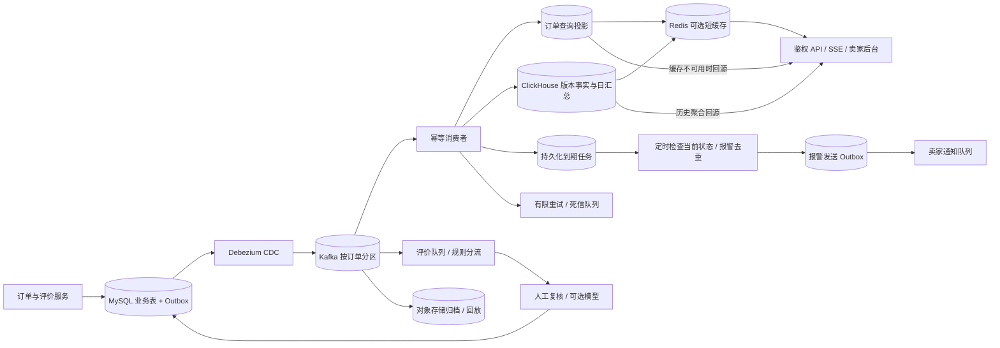

# Q5.1 实时数据管道设计

这是设计方案，尚未部署或做线上压测。所有延迟均为验收目标；本次 Q4 不调用外部模型，图中的模型通道仅为未来可选扩展。

## 存储、时效与正确性

业务表及 Outbox 在同一 MySQL 事务写入，避免订单成功但消息丢失；CDC 读取提交后的变化，事件带 event_id、order_id、seller_id、版本和发生时间。[Outbox 机制依据](https://debezium.io/documentation/reference/stable/transformations/outbox-event-router.html)。Kafka 保存可回放事件，按订单分区维持局部顺序，不承担后台查询。

订单投影采用至少一次消费：event_id 唯一约束、版本检查与状态更新在同一数据库事务完成，再提交消费位点；崩溃重试不重复生效。跨存储分别幂等，不能把消息系统事务说成端到端恰好一次。[交付语义依据](https://kafka.apache.org/43/design/design/)。冷启动先做一致性快照并记录日志位点，再追平增量；坏数据有限退避后进入死信队列，人工修复回放。

订单从提交到后台展示目标为 p99 小于 30 秒：CDC、排队、处理及推送各预算 5 秒，另留 10 秒余量；记录端到端时间与积压告警。页面用 SSE 更新，断连后重连补查。评价独立排队，目标 60 秒内启动分析；启动与完成分别计时，模型慢不会阻塞订单链路。

物流到期任务保存 order_id、due_at 与截止时间版本，按 due_at 索引每 5 秒领取到期任务。发送前重查是否已送达、取消或改期，用订单和截止版本去重，报警记录与发送 Outbox 同事务落库，异步重试发送；不能先标为已通知再发送。重启后补扫，避免没有新事件就永远不报警。发送与状态更新仍可能竞态，通知附状态核验时间。

MySQL 保存交易真相和当前查询投影；ClickHouse 按月份分区、卖家与日期排序，存版本事实及卖家日汇总。事实查询按最高版本去重，汇总由已去重状态计算，并用带版本的整日结果替换发布；退款及迟到事件重算受影响日期。不能依赖 ReplacingMergeTree 后台合并立即消除重复。[引擎限制](https://clickhouse.com/docs/reference/engines/table-engines/mergetree-family/replacingmergetree)。六个月曲线只读约 180 个日点，目标 p95 小于 100ms，需用真实并发压测；Redis 缓存 5 秒并按版本失效，缓存故障回源并限制并发，避免击穿拖垮数据库。API 从登录身份限定 seller_id，禁止信任客户端传入租户。

## 规模与模型预算

十万、百万单每天平均分别约 1.16、11.57 单/秒。假设每单十个事件、峰值二十倍，未来约 2315 事件/秒；每事件 1KB，则每日约 10GB，保留三十天、三副本约 900GB，未含索引和余量。当前采用少量消费者及单个分析分片的副本组，不引入复杂流计算框架；增长后依据积压、分区热点和压测扩分区与分片，存储扩容预留迁移时间。归档及备份定期恢复演练。

假设每单一条评价、每条输入 600、输出 200 token，假设单价为每百万 $2/$8，则每条 $0.0028。百万单全调用一年约 $1,022,000；十万单约 $102,200。若只有两成订单留评，其中一成需模型，百万单年费用约 $20,440。以上是规划假设，非供应商报价，不含人工与基础设施。空文与简单文本用规则，重复内容按文本、语言及规则/模型版本缓存；令牌上限、并发限流、每日预算预留和硬上限共同控费，预算不足转复核而不伪造结果。

## 三大风险与应对

1. 丢失、乱序或重复使指标和报警错误：版本幂等、持久化定时器、源表对账、回放与故障演练；超时展示数据更新时间。
2. 模型误判、提示注入与预算超限：评价仅作数据、不给工具权限，强制 JSON 和原文证据校验；分层盲审，风险结论人工确认，熔断后排队。
3. 大卖家热点及租户泄露：读写限额、隔离任务池、跨租户越权测试，敏感信息脱敏、最小权限及审计；失败时保留最后一致快照并标明陈旧状态。
